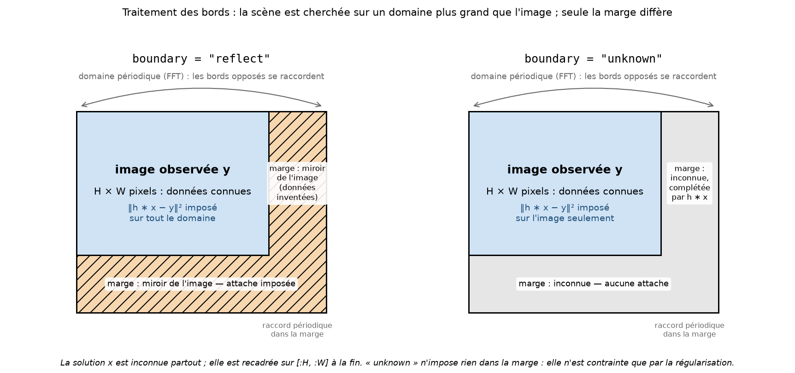
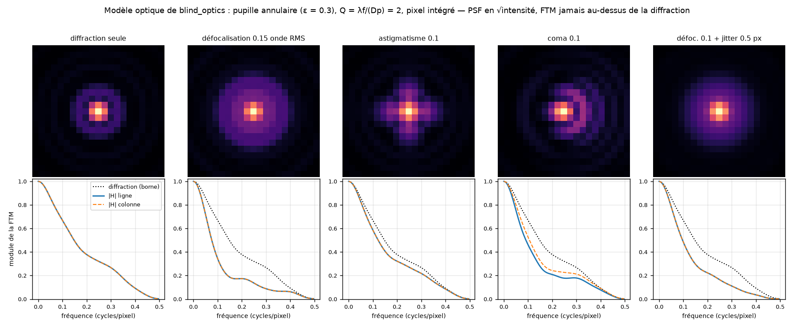

# Référence technique — eoqual-deconvolution

Principe, implémentation, paramètres et limites de chaque méthode. Les
résultats chiffrés sont dans [BENCHMARK.md](BENCHMARK.md), les
références complètes dans [BIBLIOGRAPHY.md](BIBLIOGRAPHY.md).

## Sommaire

1. [Modèle et notations](#1-modèle-et-notations)
2. [Bords et données incomplètes](#2-bords-et-données-incomplètes)
3. [Méthodes linéaires](#3-méthodes-linéaires)
4. [Méthodes itératives](#4-méthodes-itératives)
5. [Choix du paramètre des méthodes linéaires](#5-choix-du-paramètre-des-méthodes-linéaires)
6. [Méthodes variationnelles](#6-méthodes-variationnelles)
7. [Plug-and-Play](#7-plug-and-play)
8. [Déconvolution aveugle](#8-déconvolution-aveugle)
9. [Optimisation des paramètres](#9-optimisation-des-paramètres)
10. [PSF, simulation, figures](#10-psf-simulation-figures)
11. [Tests](#11-tests)
12. [Évolutions envisagées](#12-évolutions-envisagées)
- [Annexe A — Historique des choix et corrections](#annexe-a--historique-des-choix-et-corrections)

---

## 1. Modèle et notations

Observation ``y = h ∗ x + b`` : scène ``x``, PSF ``h`` (positive, somme
1), bruit ``b`` blanc d'écart-type σ. Sur un domaine périodique de ``N``
pixels, avec la FFT non normalisée : ``Y = H·X + B``, ``E|B(ω)|² = Nσ²``,
``H = psf2otf(h)`` (eoqual-core : centre de la PSF ``(kh // 2, kw // 2)``
ramené à l'origine, donc ``H`` réelle pour une PSF symétrique).

``BlurOperator`` (``operators.py``) porte ``H``, les opérations
``Hx``, ``Hᵀx``, le gradient ``Hᵀ(Hx − y)`` de ``½‖Hx − y‖²`` et sa
constante de Lipschitz ``max|H|²`` (1 pour une PSF positive de somme 1).

**Pourquoi la FFT.** La convolution est une application linéaire
``y = Hx`` dont la matrice ``N × N`` est inutilisable telle quelle
(10¹⁰ coefficients pour 10⁵ pixels). Sur un domaine périodique, ``H`` est
**circulante par blocs à blocs circulants** (BCCB) : la transformée de
Fourier discrète la diagonalise, et ses valeurs propres sont les
coefficients ``H(ω)``. ``Hx``, ``Hᵀx`` (multiplication par ``H*``) et
``(HᵀH + λLᵀL)⁻¹`` (division par ``|H|² + λ|L|²`` si ``L`` est aussi une
convolution) coûtent une FFT, ``O(N log N)``. Tout l'enjeu du traitement
des bords (§2) est de rendre ce cadre périodique légitime pour une image
qui ne l'est pas. Illustration pas à pas : [TUTORIEL.md](TUTORIEL.md) §1.

**Unités.** σ est toujours dans les unités de l'image. Les méthodes non
linéaires travaillent sur l'image ramenée à [0, 1] (``data_range``,
défaut : min/max de l'image) et expriment leur poids de régularisation en
**multiples de σ** ; les méthodes linéaires ont des paramètres sans
dimension. Toutes sont donc invariantes par changement d'échelle et de
décalage (sauf Richardson-Lucy : échelle seulement, modèle de Poisson),
ce que vérifie ``tests/test_methods.py::test_scale_invariance``.

**σ inconnu.** ``sigma=None`` : estimation de Donoho & Johnstone sur la
sous-bande d'ondelettes diagonale la plus fine
(``eoqual.core.noise.estimate_noise_sigma``, identique à
``skimage.restoration.estimate_sigma``). Sur une image floue, cette
sous-bande contient peu de signal : l'estimation est fiable (±15 % dans
les tests) ; elle sous-estime un bruit corrélé.

## 2. Bords et données incomplètes

### 2.1 Bords

Toutes les méthodes résolvent le problème sur un domaine périodique. Une
image réelle ne l'est pas : la discontinuité entre bords opposés produit
des oscillations sur toute l'image restaurée. ``boundary`` :

- **``"reflect"``** : l'image est prolongée d'une marge d'au moins deux
  tailles de PSF au total (taille rapide pour la FFT), placée après
  l'image. Dans la marge, le miroir du bord de fin se fond, par une
  pondération en cosinus surélevé, dans le miroir du bord de début : le
  domaine de travail est **continu et périodique**. La marge est traitée
  comme mesurée. Le résultat est recadré sur ``[:H, :W]`` ;
- **``"unknown"``** : même marge, mais traitée comme une **donnée
  inconnue** (§2.2) : seule l'image d'origine contraint la solution
  (Almeida & Figueiredo 2013). Le plus exact ;
- **``"perdecomp"``** : décomposition périodique + lisse de Moisan
  (eoqual-core) ; seule la composante périodique est déconvoluée, la
  composante lisse (basses fréquences, quasi insensible au flou) est
  rajoutée. Pas de marge, approximatif près des bords ; incompatible avec
  ``mask`` et ``saturation`` ;
- **``"periodic"``** : aucun traitement, exact pour une simulation par
  convolution circulaire.

#### Le mode ``"unknown"`` en détail

**Le problème.** Près d'un bord, chaque pixel observé mélange, par le
flou, des points de la scène situés *hors du champ* : la scène réelle se
poursuit au-delà de l'image, mais on n'en a aucune mesure. La FFT, elle,
suppose que l'image se répète périodiquement : le bord droit « touche »
le bord gauche. Le modèle ``y = h ∗ x`` est donc faux sur une bande de la
largeur de la PSF autour de l'image.

**L'idée.** On cherche une scène ``x`` **plus grande que l'image** —
l'image plus une marge — et on n'impose l'accord avec les données que là
où il y a des données (Almeida & Figueiredo 2013) :



*Schéma régénérable par `python examples/figures.py`.*

``min_x ‖C(h ∗ x) − y‖² + R(x)``, où ``C`` ne garde que les pixels de
l'image. La marge de ``x`` n'est contrainte que par la régularisation
``R`` et par la continuité avec l'image : c'est une **extrapolation** de
la scène hors du champ, que l'on jette à la fin (recadrage sur
``[:H, :W]``). La FFT reste utilisable, puisque le domaine de travail
complet, lui, est traité comme périodique : la discontinuité au raccord
tombe dans une zone où rien n'est imposé.

**Mise en œuvre.** Plutôt qu'un opérateur de recadrage explicite, les
données de la marge sont **complétées à chaque itération par le flou de
l'estimée courante**, ``h ∗ x`` (§2.2) : le résidu y est nul, donc la
marge ne tire pas la solution. Pour les méthodes à gradient (Landweber,
FISTA, TV, Plug-and-Play), c'est exactement le gradient du problème
ci-dessus ; pour les méthodes linéaires, la boucle « compléter puis
résoudre » (``n_fill_iter = 30``) converge vers sa solution (EM).

**Différence avec ``"reflect"``.** ``"reflect"`` remplit la marge de
*données inventées* (le miroir de l'image) et demande à la solution de
les expliquer. Or un miroir n'est pas une image floue par la PSF — le
flou d'un bougé, par exemple, n'est pas symétrique : l'incohérence est
amplifiée par l'inversion, d'autant plus que la FTM a des zéros.
``"unknown"`` ne fait aucune hypothèse sur la scène hors champ.

| Flou de bougé, TV (TUTORIEL.md §7) | PSNR |
|---|---|
| ``"periodic"`` (rien) | 18.14 dB |
| ``"reflect"`` (marge inventée) | 27.67 dB |
| ``"unknown"`` (marge inconnue) | 29.74 dB |

**Coût.** Aucun pour les méthodes itératives ; ``n_fill_iter`` FFT
supplémentaires pour les méthodes linéaires (0.1 à 0.3 s pour 512×256).

**Quand le préférer.** Toujours acceptable ; indispensable dès que la
FTM s'annule (bougé, défocalisation forte). Exception mesurée :
Richardson-Lucy et Landweber, régularisés par le nombre d'itérations,
gardent ``"reflect"`` — les données de la marge y freinent utilement
l'amplification du bruit près des bords.

**Défaut par méthode**, d'après les mesures (BENCHMARK.md §4) :

| Méthodes | Défaut | Raison |
|---|---|---|
| ``wiener``, ``tikhonov``, ``fista_wavelet``, ``tv_primal_dual`` | ``"unknown"`` | +0.8 à +2.2 dB sur flou de bougé (OTF à zéros), au plus −0.06 dB ailleurs |
| ``inverse``, ``richardson_lucy``, ``landweber`` | ``"reflect"`` | ``"unknown"`` y est neutre (Richardson-Lucy : +0.07 dB) ou défavorable (inverse, Landweber : jusqu'à −0.5 dB) : régularisées par un seuil ou le nombre d'itérations, elles profitent des données synthétiques de la marge |
| ``pnp_hqs``, ``pnp_admm`` | ``"reflect"`` | marge déjà complétée (``fill_boundary``, §7) : identique à ``"unknown"`` |

Un miroir simple de chaque côté (``np.pad(..., "symmetric")``) laisse une
discontinuité au raccord périodique des deux marges. Son énergie haute
fréquence, inexpliquée par le flou, faussait les critères de réglage :
GCV et discrépance choisissaient λ ≈ 1e-10 (Tikhonov à −33 dB). Voir
l'annexe A.

### 2.2 Données incomplètes : pixels masqués, saturés, marge inconnue

``backends/_common.py``. Chaque pixel du domaine de travail est :

- **connu** : attache aux données ``(h ∗ x − y)²`` ;
- **inconnu** (``mask=False``, NaN, marge de ``"unknown"``) : aucune
  attache ; la valeur initiale est celle du plus proche pixel connu ;
- **saturé** (``saturation=L``, pixels valides ``≥ L``) : la vraie valeur
  floue est seulement connue pour être ``≥ L`` ; attache unilatérale
  ``min(h ∗ x − L, 0)²``.

Toutes les méthodes (sauf ``wiener_unsupervised`` et ``blind_l0``, qui
refusent ces options) passent par la même opération ``Problem.fill`` :
les données sont **complétées par l'estimée courante**, ``h ∗ x`` aux
pixels inconnus et ``max(h ∗ x, L)`` aux pixels saturés.

- **Méthodes à gradient** (Landweber, FISTA, TV) : ``Hᵀ(Hx − fill(Hx))``
  est exactement le gradient de l'attache masquée et unilatérale.
- **Méthodes linéaires** (inverse, Wiener, Tikhonov) : la boucle
  « compléter puis résoudre » (``n_fill_iter = 30``) est l'algorithme EM
  des données manquantes (Dempster, Laird & Rubin 1977) ; son point fixe
  vérifie ``Hᵀ M (Hx − y) + λLᵀL x = 0``, l'équation normale du problème
  masqué. Coût : ``n_fill_iter`` FFT supplémentaires (0.1 à 0.3 s pour
  512×256).
- **Richardson-Lucy** : ``x ← x · Hᵀ(fill(Hx) / Hx)``, l'EM du modèle de
  Poisson à données manquantes ; pour des bords inconnus, c'est la
  méthode de Bertero & Boccacci (2005).
- **Plug-and-Play** : remplissage à chaque itération (§7).
- Le principe de discrépance (Landweber, Tikhonov) compte les seuls
  pixels connus.

Mesures (flou gaussien σ = 2 px, bruit 0.01, image d'évaluation du
benchmark, BENCHMARK.md §4) :

- **une ligne sur 25 à 0** : sans masque, l'image est détruite (−56 à
  +15 dB selon la méthode) ; avec ``mask=``, à 0.15 dB au plus de la
  restauration sans défaut ;
- **flou écrêté à 85 % de son maximum** (6 % de pixels saturés) :
  +0.3 à +1.4 dB avec ``saturation=`` (TV : 28.19 → 29.59 dB), sans
  changement hors des zones saturées ;
- **flou de bougé, marge inconnue** : voir le tableau du §2.1.

## 3. Méthodes linéaires

Une FFT, aucune itération — sauf sur données incomplètes, où la boucle
de remplissage du §2.2 en enchaîne ``n_fill_iter``.

### 3.1 `inverse` — filtre inverse tronqué

``X = Y/H`` là où ``|H| ≥ threshold`` (défaut 0.15), 0 ailleurs. Sans
modèle de bruit ; amplifie le bruit d'un facteur ``1/threshold``.
Méthode de référence.

### 3.2 `wiener` — Wiener, spectre du signal ajusté

``X = H* Y / (|H|² + Sb/Sx)``.

- ``nsr`` donné : rapport constant (équivaut à Tikhonov ``identity``,
  vérifié par test) ;
- ``nsr=None`` (défaut) : ``Sx(ω) = A|ω|^-β``. Dans la bande où le flou
  est faible (``|H|² ≥ 0.1``), ``Ŝ = (|Y|² − Nσ²)/|H|²`` estime
  directement le spectre du signal ; sa moyenne par couronnes
  logarithmiques est ajustée en ``log A − β log|ω|`` (``β`` borné à
  [0.5, 4]). Le modèle prolonge ``Sx`` aux hautes fréquences, masquées
  par le flou. Le rapport bruit/signal croît donc avec la fréquence.

Résultat : à 0.3-0.4 dB du Wiener « oracle » (vrai spectre de la scène)
sur trois flous gaussiens. Avec β = 2 imposé (première version), l'écart
atteignait 3.4 dB.

### 3.3 `wiener_unsupervised` — Wiener non supervisé

Appel de ``skimage.restoration.unsupervised_wiener`` (Orieux et al.
2010) : niveaux de bruit et de régularisation laplacienne estimés par
échantillonnage de Gibbs ; ``sigma`` ignoré, graine fixée (``seed=0``).

### 3.4 `tikhonov`

``min ‖h ∗ x − y‖² + λ‖Lx‖²``, ``X = H*Y/(|H|² + λ|L|²)``, avec
``|L|²`` = 1 (``identity``), ``4sin²(πf_y) + 4sin²(πf_x)``
(``gradient``, différences avant) ou son carré (``laplacian``, défaut).
``lam=None`` : λ choisi par ``rule`` (§5).

### 3.5 `wiener_hunt` — Wiener–Hunt, λ et σ par vraisemblance marginale

**Origine.** Le filtre de Wiener (1949) suppose connus les spectres de
la scène ``Sx`` et du bruit ``Sb`` : ``X = H* Y / (|H|² + Sb/Sx)``. Ni
l'un ni l'autre ne l'est en pratique. Hunt (1973) remplace le spectre de
la scène par une **contrainte de régularité** : parmi les images
compatibles avec les données au niveau du bruit
(``‖y − h ∗ x‖² = Nσ²``), prendre la plus lisse au sens de ``‖Dx‖²``,
``D`` laplacien (moindres carrés contraints). Par multiplicateur de
Lagrange :

    X = H* Y / (|H|² + λ |D|²),   |D(ω)|² = (4sin²(πf_y) + 4sin²(πf_x))²

C'est un filtre de Wiener dont le rapport signal/bruit est imposé :
``Sx/Sb = 1/(λ|D|²)``, soit un spectre de scène en ``|ω|⁻⁴`` aux basses
fréquences.

**Lecture bayésienne** (Orieux, Giovannelli & Rodet 2010). A priori
gaussien ``p(x) ∝ exp(−γ_x ‖Dx‖²/2)``, bruit blanc gaussien
``p(y | x) ∝ exp(−γ_b ‖y − h ∗ x‖²/2)`` : la loi a posteriori est
gaussienne, son maximum (et sa moyenne) est le filtre ci-dessus avec
``λ = γ_x / γ_b``, et ``σ² = 1/γ_b``. Le filtre est donc celui de
``tikhonov`` avec ``regularizer="laplacian"`` (§3.4, vérifié à 1e-10
près par test) ; **ce qui définit la méthode est le choix de λ et σ**.

**Choix de λ et σ : vraisemblance marginale** (« evidence » : MacKay
1992 ; Molina 1994). La scène s'intègre analytiquement :
``y ~ N(0, γ_x⁻¹ H (DᵀD)⁻¹ Hᵀ + γ_b⁻¹ I)``, matrice circulante,
diagonale en Fourier. Chaque coefficient ``Y(ω)`` est gaussien
complexe, indépendant, de variance

    E|Y(ω)|²/N = v(ω) = σ² · s(ω),   s(ω) = 1 + |H(ω)|² / (λ |D(ω)|²)

et, à des constantes près, avec ``P(ω) = |Y(ω)|²/N`` :

    −log p(y | λ, σ²) = Σ_ω [ log v(ω) + P(ω)/v(ω) ]

σ² se profile analytiquement (``σ̂² = moyenne_ω(P/s)``), ce qui laisse
un critère à une dimension, ``J(λ) = Σ log s + M log σ̂²(λ)`` (``M``
fréquences), minimisé par balayage logarithmique puis recherche bornée
(``tuning.criteria.wiener_hunt_estimate``). La fréquence nulle est
exclue : ``D(0) = 0``, l'a priori ne dit rien de la moyenne (impropre).
Si ``sigma`` est donné, seul λ est estimé.

Intuition : aux hautes fréquences, où ``|H|²`` est petit, ``s ≈ 1`` et
``P`` mesure directement le bruit ; aux basses fréquences, ``P`` mesure
le signal filtré, et λ règle la transition. Le critère pénalise à la
fois un modèle trop peu régularisé (variance prédite trop grande, terme
``log v``) et trop régularisé (énergie observée inexpliquée, terme
``P/v``) — sans référence ni connaissance du bruit.

**Liens avec les autres méthodes linéaires.**

| Méthode | Spectre de la scène | Niveau (λ, σ) |
|---|---|---|
| ``wiener`` | ``A|ω|^-β``, A et β ajustés par régression dans la bande peu floue | σ estimé (ondelettes) |
| ``wiener_hunt`` | ``∝ 1/|D|²`` (laplacien : ``|ω|⁻⁴``) | λ et σ par vraisemblance marginale |
| ``tikhonov`` | même filtre que ``wiener_hunt`` | λ par GCV, discrépance, ou ``rule="evidence"`` (même critère) |
| ``wiener_unsupervised`` | même modèle que ``wiener_hunt`` | λ et σ par échantillonnage de Gibbs (moyenne a posteriori), scikit-image |

``wiener_hunt`` est la version **déterministe** du Wiener–Hunt non
supervisé : maximum de la vraisemblance marginale (bayésien empirique)
au lieu de l'échantillonnage de la loi a posteriori des hyperparamètres.
Instantané (une FFT et ~80 évaluations d'une somme), et il hérite de
l'infrastructure commune : marge inconnue (``boundary="unknown"``,
défaut), pixels masqués et saturés (§2.2), ce que ``wiener_unsupervised``
ne gère pas.

**Mesures** (BENCHMARK.md, 24 cas : deux scènes, quatre flous — gaussien,
Airy, bougé, PSF optique aberrée —, trois niveaux de bruit) : PSNR moyen
30.70 dB, contre 30.67 (``tikhonov``, GCV), 30.64 (``wiener``) et 29.55
(``wiener_unsupervised``) ; écart à ``tikhonov`` de −0.68 à +0.38 dB, gain
sur ``wiener_unsupervised`` de +0.03 à +8.8 dB (bougé à faible bruit :
22.4 dB pour ``wiener_unsupervised`` contre 31.1 dB). σ estimé à 3 % près (médiane), au pire 50 %
trop grand pour un bougé (FTO nulle par endroits) à σ = 0.003. L'a priori
``gradient`` (spectre en ``|ω|⁻²``) perd 0.8 dB en moyenne : Hunt avait
raison de prendre le laplacien pour fixer λ ; on verra au §8.2 qu'un
exposant intermédiaire (β = 3) est préférable pour **estimer la PSF**.

``tuning.criteria.evidence_curve`` trace le critère en fonction de λ ;
``backends.linear.wiener_hunt_parameters`` renvoie λ, σ et le critère.

## 4. Méthodes itératives

Le nombre d'itérations régularise (semi-convergence) : trop peu, l'image
reste floue ; trop, le bruit est amplifié.

### 4.1 `richardson_lucy`

``x ← x · Hᵀ(y / Hx)`` : maximum de vraisemblance pour un bruit de
Poisson, positivité préservée. Départ : image constante (moyenne).

- **Accélération** (défaut) : extrapolation vectorielle de Biggs &
  Andrews (1997), ordre 1 : ``z = x_k + α(x_k − x_{k−1})``,
  ``α = ⟨g_{k−1}, g_{k−2}⟩ / ‖g_{k−2}‖²`` borné à [0, 1], ``g`` = pas
  RL. Résultat comparable en 3 à 5 fois moins d'itérations.
- **TV** (``tv_weight``, Dey et al. 2006) : division par
  ``1 − λ div(∇x/|∇x|)`` (bornée à 0.1).
- Image négative (fond soustrait) : décalée de son minimum, puis recalée.
- Défaut ``n_iter = 50`` (accélérées) **avec** ``tv_weight = 0.005`` :
  la TV stabilise les itérations, si bien que le résultat dépend peu de
  leur nombre — meilleur PSNR moyen sur quatre flous et trois niveaux de
  bruit, +1.4 dB sur l'ancien défaut (12 itérations sans TV) et jamais
  pire (§9.1). Sans TV (``tv_weight=0``), RL pur exige d'arrêter tôt :
  12 à 20 itérations pour un flou gaussien σ = 2 px, 5 à 8 pour une tache
  d'Airy à Nyquist.

### 4.2 `landweber`

``x ← P₊(x − τHᵀ(Hx − y))``, ``τ = 1.9/max|H|²``. Arrêt par défaut au
**principe de discrépance** (``‖Hx − y‖² ≤ Nσ²``, plafond 500
itérations) : le nombre d'itérations s'adapte au flou, à 0.2-0.8 dB du
meilleur nombre fixe sur trois des quatre flous et au-dessus sur le
quatrième (Airy), alors qu'aucun nombre fixe ne convient aux quatre.

**Pas de Barzilai-Borwein** (``acceleration=True``, Barzilai & Borwein
1988) : ``τ_k = ‖s‖²/‖Hs‖²`` avec ``s = x_k − x_{k−1}`` — l'inverse du
quotient de Rayleigh de ``HᵀH`` dans la direction du dernier pas, exact
pour une attache quadratique — borné à ``[0.5, 50]/max|H|²``. Quand la
discrépance est atteignable, elle l'est en 3 à 4 fois moins d'itérations
pour le même PSNR (flou gaussien, σ = 0.002 : 63 → 23 itérations ;
σ = 0.0005 : 562 → 131). Sans projection ni recherche linéaire
non monotone, il n'est pas robuste quand le résidu plafonne au-dessus de
``Nσ²`` (bougé à très faible bruit : −2.6 dB) : désactivé par défaut.

## 5. Choix du paramètre des méthodes linéaires

``tuning/criteria.py``. Matrice d'influence diagonale
``S_λ = |H|²/(|H|² + λ|L|²)``, résidu ``(1/N)Σ|(1 − S_λ)Y|²``.

| Règle | Critère | Requiert σ | Comportement mesuré |
|---|---|---|---|
| ``gcv`` (défaut) | ``(1/N)‖(I − S)y‖² / (1 − tr S/N)²`` minimal | non | à 0.05 dB de l'optimum avec ``gradient``/``laplacian`` sur flou gaussien ; **sous-régularise de 2 dB avec ``identity``** ; sous-régularise sur flou de bougé (OTF à zéros) |
| ``discrepancy`` | résidu = ``Nσ²`` (bisection en log λ) | oui (estimé sinon) | optimal avec ``identity`` ; sur-régularise de 1 à 1.3 dB avec ``gradient``/``laplacian`` sur flou gaussien ; meilleur SSIM |
| ``evidence`` | vraisemblance marginale de Wiener–Hunt maximale (§3.5) | non (estimé avec λ ; utilisé s'il est donné) | équivalent à GCV en moyenne (+0.02 dB sur 24 cas avec ``laplacian``), donne σ en plus ; défaut de ``wiener_hunt`` |
| L-curve | coin de ``(log‖résidu‖, log‖Lx‖)`` | non | diagnostic seulement (``l_curve``), moins stable |

GCV estime l'erreur de prédiction en supposant implicitement un signal
« blanc » ; une image naturelle concentre son énergie aux basses
fréquences, d'où la sous-régularisation avec ``L = I``. Les opérateurs
dérivatifs compensent en partie ce défaut. Recherche : balayage
logarithmique de 1e-10 à 1e3 (66 points) puis recherche bornée autour du
minimum. ``plotting.plot_gcv`` trace les deux critères.

## 6. Méthodes variationnelles

### 6.1 `fista_wavelet`

``min ½‖Hx − y‖² + λ‖Wx‖₁``, ``W`` ondelettes orthogonales
(PyWavelets, périodisation, coefficients de détail seulement), FISTA
(Beck & Teboulle 2009) : seuillage doux à ``λσ/max|H|²``. Les dimensions
de travail sont des multiples de ``2^levels`` (marge ``reflect``).
Défauts ``lam = 0.15`` (× σ), ``levels = 5`` (§9.1).

**Cycle spinning** (défaut) : la grille d'ondelettes est décalée
aléatoirement à chaque itération (Figueiredo & Nowak 2003), ce qui
supprime les artefacts en blocs d'une base décimée. L'objectif n'est
alors plus strictement décroissant (problème invariant par translation
en moyenne).

### 6.2 `tv_primal_dual`

``min ½‖Hx − y‖² + λTV(x) [+ ι(x ≥ 0)]``, TV isotrope (différences
avant périodiques), algorithme de Condat-Vũ avec le terme d'attache aux
données traité par son gradient :

```
x ← P(x − τ(Hᵀ(Hx − y) − div p))
p ← Proj_{‖·‖₂ ≤ λ}(p + σ_d ∇(2x_new − x))
```

Pas ``τ = 0.99/‖H‖²``, ``σ_d = ‖H‖²/16`` : la condition
``1/τ − 8σ_d ≥ ‖H‖²/2`` est satisfaite (``‖∇‖² ≤ 8``). Arrêt à
``‖Δx‖/‖x‖ < 1e-5`` ou ``n_iter = 300``. ``lam = 0.1`` (× σ) par défaut : médiane des optimums du benchmark (0.04 à 0.17).
La décroissance de l'objectif est vérifiée par test, et l'optimum par une
solution de référence indépendante : sur une image 24×24, la valeur de la
fonctionnelle atteinte égale celle de CVXPY (solveur Clarabel) à 1e-6
près, et la solution en diffère de moins de 5e-3
(``tests/test_reference_cvxpy.py``, Diamond & Boyd 2016).

## 7. Plug-and-Play

``backends/pnp.py``. Problème ``½‖Hx − y‖²/σ² + λΦ(x)``, l'a priori
``Φ`` n'étant connu qu'à travers un débruiteur ``D(·, σ_k)``.

- **HQS** : ``μ_k = λ/σ_k²`` ; pas en ``x`` exact en Fourier,
  ``X = (H*Y + α_k Z)/(|H|² + α_k)`` avec ``α_k = λσ²/σ_k²`` ; puis
  ``z = D(x, σ_k)``.
- **ADMM** : même pas appliqué à ``z − u``, ``z = D(x + u, σ_k)``,
  ``u ← u + x − z``. La variable duale réduite ``u`` est remise à
  l'échelle (``u ← u·α_{k−1}/α_k``) quand le pas change.
- **Calendrier** : ``σ_k`` décroît géométriquement de ``sigma_start`` à
  ``max(σ, sigma_min)``, en ``n_iter`` pas (8 pour HQS, 12 pour ADMM).
  ``sigma_start`` = 0.05 (HQS) et 0.1 (ADMM) de la dynamique : un départ
  plus doux que le 0.2 de Zhang et al. (2021), conçu pour des niveaux de
  bruit plus forts, gagne +1.2 dB (HQS) et +0.4 dB (ADMM) en moyenne, et
  jusqu'à +6 dB sur flou de bougé (§9.1).
- **λ** : 0.23 pour HQS (Zhang et al. 2021) ; 0.5 pour ADMM, meilleur
  compromis mesuré sur les quatre flous du benchmark (0.23 y donnait
  26-27 dB contre 35 dB sur bougé et défocus).
- **Débruiteur** : nom d'une méthode d'eoqual-denoising (``nl_ridge``
  par défaut, réimplémentation MIT, sans PyTorch ; ``drunet`` avec l'extra
  ``deep``, +1.3 à +2.9 dB sur NL-Ridge en HQS, deux fois plus rapide sur
  Apple Silicon) ou fonction ``f(image, sigma)``. Il reçoit l'image ramenée à
  [0, 1] et σ dans ces unités ; ``data_range=(0, 1)`` lui est imposé s'il
  l'accepte (sinon il le déduirait du min/max de l'itéré, qui varie).
- **Tout débruiteur convient** : non local (``nl_means``, ``nl_bayes``),
  ``bilateral``, réseaux (``drunet``, ``swinir``...). Comparer plusieurs a
  priori dans le même algorithme se fait donc en changeant un argument.
- **Données incomplètes et marge** : à partir de la 2ᵉ itération, les
  données sont complétées par le flou de l'estimée courante ``z`` (§2.2) :
  pixels masqués, saturés et, avec ``boundary="reflect"``, la marge ; les
  vraies données ne sont imposées que sur les pixels connus de l'image
  d'origine. Sans ce remplacement, le pas en ``x`` presque inverse des
  premières itérations amplifie la marge, qui n'est pas une image floue :
  sur flou de bougé, HQS-DRUNet passait de 36.0 dB (simulation
  périodique) à 26.9 dB (bords réels) ; avec le remplacement, 32.3 dB.
  Contrepartie : −0.5 à −1 dB sur flou gaussien et défocalisation avec
  NL-Ridge (OTF sans zéro, marge déjà peu gênante). Un remplacement à
  partir de la moitié des itérations ne sauve pas le bougé (25 dB) : il
  est donc fait dès la 2ᵉ itération ; ``fill_boundary=False`` le
  désactive.

## 8. Déconvolution aveugle

Deux approches, qui diffèrent par ce que l'on sait de la PSF :

| | ``blind_l0`` (§8.1) | ``blind_optics`` (§8.2) |
|---|---|---|
| PSF | tableau libre ``k × k`` (positif, somme 1) | PSF d'un modèle physique de l'instrument (diffraction, aberrations de Zernike, jitter, pixel) |
| Inconnues | ``k²`` valeurs (225 pour 15 × 15) | 1 à 5 paramètres physiques bornés |
| Connaissance requise | taille du support | échantillonnage ``Q``, pupille, plages plausibles des aberrations |
| Cas d'usage | flou inconnu de forme quelconque (bougé) | instrument connu, réglage dérivé (défocalisation thermique, aberrations, variation dans le champ) |
| Risque | confondre détails de la scène et flou ; PSF non physique | modèle faux ou incomplet ; confusions résiduelles (§8.2.5) |

### 8.1 `blind_l0` — PSF libre, a priori L0

``backends/blind.py`` : ``blind_deconvolve(image, psf_size, sigma)``
renvoie ``(image, psf)`` ; ``blind_l0`` en est la forme à signature
commune (image seulement). **Expérimentale** : toujours examiner la PSF
estimée (``plotting.plot_psf``).

**Estimation de la PSF** (a priori L0 sur les gradients, Xu et al. 2013 ;
Pan et al. 2014), du grossier au fin (facteur √2, jusqu'à un support de
3 à 5 pixels) :

1. **pas en x** : ``min ‖h ∗ x − y‖² + λ‖∇x‖₀`` par éclatement
   semi-quadratique (Xu et al. 2011) : seuillage dur de ``∇x`` à
   ``√(λ/β)`` puis solution exacte en Fourier, ``β`` de 2λ à 1e5 par
   doublements. **Départ : l'image observée** — un départ par filtre
   inverse amplifie un bruit que le seuillage conserve ensuite comme
   contours ;
2. **pas en h** : ``min ‖h ∗ ∇x − ∇y‖² + γ‖h‖²`` (domaine des gradients,
   spectre presque plat), solution exacte en Fourier, ``γ = 1e-4·max|∇X|²``,
   restreinte au support, valeurs négatives et < 5 % du maximum annulées,
   somme 1, barycentre recentré ;
3. ``λ`` part de ``lam_l0 = 4e-3`` (image en [0, 1], valeur de Pan et
   al.) et décroît d'un facteur 0.9 par itération (plancher 1e-4) ;
   6 alternances par échelle.

**Restauration finale** : ``tv_primal_dual`` avec la PSF estimée
(``lam = 0.4``).

**Limites.** Gain de +0.5 à +4.2 dB selon la scène et le flou (contre
+4.5 à +6.9 dB pour la TV à PSF connue), variable d'une scène et d'un tirage à l'autre. La PSF n'est
définie qu'à une translation près (recentrée sur son barycentre) : le
résultat peut être décalé d'une fraction de pixel. Choisir ``psf_size``
proche de l'étendue attendue du flou : un support trop grand dégrade
fortement le résultat (sur l'image du benchmark, 21 px au lieu de 9 à
17 : −1 à −2 dB au lieu de +3 à +4 dB), un support un peu trop petit est
bien toléré.

### 8.2 `blind_optics` — aveugle contrainte par l'optique

``backends/optics_blind.py`` : ``optics_blind_deconvolve(image, model,
sigma)`` renvoie un ``OpticsBlindResult`` (image, PSF, paramètres
estimés, σ, tuiles) ; ``blind_optics`` en est la forme à signature
commune (modèle par mots-clés). Exemple complet :
``examples/blind_optics.py`` ; banc d'essai :
``examples/blind_optics_benchmark.py``.

#### 8.2.1 Pourquoi contraindre la PSF

Une déconvolution aveugle générique cherche ``(x, h)`` tels que
``h ∗ x ≈ y`` : le problème a deux fois plus d'inconnues que de mesures
et une infinité de solutions exactes, dont la solution triviale
``h = δ, x = y`` (« l'image n'est pas floue »). Ce qui départage les
solutions est **l'a priori** : sur ``x`` (contours parcimonieux, §8.1) et
sur ``h``. Un ``h`` libre de 225 valeurs peut absorber une part de la
scène (une texture régulière, un bord dominant) ou prendre une forme
qu'aucune optique ne produit. Pour un instrument dont on connaît la
conception, l'essentiel de la PSF est **connu** : diffraction par une
pupille de géométrie connue, échantillonnage par le détecteur, et seuls
quelques défauts sont inconnus et lentement variables — défocalisation
(dilatation thermique, vieillissement), aberrations de bas ordre
(astigmatisme, coma, sphérique), jitter. Contraindre ``h`` à ce modèle
ramène l'inconnue à quelques paramètres **bornés à des plages
plausibles**, et produit une PSF physique par construction :

- positive, de somme 1, aux anneaux de diffraction corrects ;
- **FTM sous la FTM de diffraction** à toute fréquence : pour une
  pupille ``P`` donnée, ``|OTF_φ(f)| = |∫ P e^{iφ} · P e^{−iφ'}| ≤
  ∫ P P' = OTF_0(f)`` (inégalité de Schwarz sur l'autocorrélation de la
  pupille) — une aberration ne relève jamais la FTM (vérifié par test).
  C'est la contrainte « |FTM| ≤ FTM d'Airy » discutée pour la 0.3.0,
  obtenue ici sans la formuler : elle est satisfaite par toute PSF du
  modèle, et la PSF de Dirac en est exclue.

#### 8.2.2 Modèle optique (``psf.optical_psf``)

Optique de Fourier (Fraunhofer), sur une grille fine de pas
``p/oversample`` (5 par défaut) :

    h = [ |TF( P(ρ, θ) · exp(2iπ W(ρ, θ)) )|² ⊛ G_jitter ] intégrée sur le pixel

- ``P`` : pupille annulaire, ``ε ≤ ρ ≤ 1`` (obturation ``ε``), bords
  anti-crénelés (``eoqual.core.psf.supersampled_coverage``) ;
- ``W = Σ_j a_j Z_j`` : front d'onde [ondes], polynômes de Zernike de
  Noll normalisés RMS 1 (``eoqual.core.pupil``) — ``a_j`` est l'écart RMS
  de front d'onde apporté par le mode ``j``, les écarts s'ajoutent en
  quadrature. Modes nommés : ``defocus`` (Z4), ``astig_45`` (Z5),
  ``astig_0`` (Z6), ``coma_y`` (Z7), ``coma_x`` (Z8), ``trefoil_y``,
  ``trefoil_x``, ``spherical`` (Z11) ; tout indice de Noll est accepté ;
- **échantillonnage** : ``Q = λf/(Dp)`` (2 : Nyquist ; ≈ 1 pour la
  plupart des imageurs d'observation de la Terre, sous-échantillonnés).
  Une pupille de ``D_px`` échantillons dans une FFT de ``N`` points donne
  un pixel focal de ``(D_px/N)·λf/D`` ; on choisit ``N`` et ``D_px``
  (≥ 48) tels que ce pixel vaille ``p/oversample`` et que la période de la
  PSF calculée couvre deux fois le support (pas de repliement des ailes) ;
- **jitter** : gaussienne d'écart-type ``jitter_sigma`` [pixels],
  appliquée en Fourier — vibrations aléatoires rapides devant le temps
  d'intégration, à ne pas confondre avec le filé (§10.1) ;
- **pixel** : somme des ``oversample²`` sous-pixels (filtre boîte, FTM
  ``sinc``, facteur de remplissage 1) ;
- **bande spectrale** : ``sampling`` peut être une séquence (``Q ∝ λ``)
  pondérée par ``weights`` ; la phase est mise à l'échelle ``λ₁/λ``.

Défocalisation physique → coefficient : un déplacement ``Δz`` du plan
focal à ouverture ``N = f/D`` donne ``W₂₀ = Δz/(8N²)`` (crête, au bord de
pupille) et ``a₄ = W₂₀/(2√3 λ)`` ondes RMS (``psf.defocus_to_zernike``).
Ordres de grandeur : 0.05 onde RMS (Strehl ≈ 0.9) est un instrument bien
réglé ; 0.25 onde RMS (Strehl ≈ 0.1) une défocalisation franche.

Validation : sans aberration, identique à l'Airy annulaire analytique de
``system_psf`` à 0.4 % du pic (trois ``Q``, trois obturations) ; 3 ms par
PSF 15 × 15 (pupille et base de Zernike mises en cache).



*Schéma régénérable par ``python examples/figures.py``.*

#### 8.2.3 Estimation par vraisemblance marginale (``estimator="evidence"``, défaut)

Le maximum **joint** ``max_{x,h} p(x, h | y)`` favorise les PSF peu
étalées : une image nette ``x`` a des gradients plus parcimonieux qu'une
image floue, mais une image restaurée avec un ``h`` trop étroit reste
« plausible » et coûte moins cher en attache aux données. Levin et al.
(2011) montrent que ce biais disparaît si l'on **intègre** l'image
(``max_h p(h | y) = max_h ∫ p(y | x, h) p(x) dx``) : on compare les PSF
par la probabilité qu'elles donnent à l'image observée, toutes scènes
confondues. C'est la démarche de la déconvolution « marginale » de
Blanco & Mugnier (2011) pour l'optique adaptative, et le prolongement
naturel de Wiener–Hunt (§3.5), où la scène est déjà intégrée
analytiquement :

    J(θ) = min_{μ}  Σ_ω log s_θ(ω) + M log( moyenne_ω P(ω)/s_θ(ω) )
    s_θ(ω) = 1 + |H_θ(ω)|² / (μ G(ω)^{β/2}),   G = 4sin²(πf_y) + 4sin²(πf_x)

- ``P = |Y|²/N`` est calculé sur la **composante périodique** de l'image
  (Moisan 2011, ``eoqual.core.fourier.perdecomp``) : sans elle, la
  discontinuité des bords ajoute une « croix » d'énergie que le critère
  prendrait pour moins de flou ;
- σ est profilé (§3.5), le niveau ``μ`` de l'a priori est optimisé à
  chaque évaluation (L-BFGS-B à gradient analytique, départ à chaud) ;
- **exposant β** du spectre a priori de la scène (``prior_exponent``,
  défaut 3) : β = 4 est l'a priori laplacien de Hunt, β = 2 le spectre en
  ``1/f²`` des images naturelles (Field 1987). Sur 18 cas (trois scènes,
  trois jeux d'aberrations, deux bruits), l'écart moyen de PSNR à la
  restauration par la vraie PSF vaut 0.84 dB avec β = 3, 0.87 dB avec β
  libre dans [2.5, 3.5], 1.02 dB avec β libre dans [1.5, 4.5] et 1.47 dB
  avec β = 4 : β libre confond une petite défocalisation avec la pente du
  spectre (pire cas 5.7 dB), β = 4 sous-estime les défocalisations ;
- θ est optimisé par L-BFGS-B dans ses bornes (gradient par différences
  finies), depuis ``n_starts`` = 3 points répartis sur la plage du
  premier paramètre (le critère n'est pas convexe en θ) ;
- ``prior_std`` ajoute un a priori gaussien ``½ Σ ((θ − θ₀)/τ)²``
  centré au milieu des bornes, quand une valeur nominale est connue avec
  une incertitude.

#### 8.2.4 Estimation par les contours (``estimator="l0"``)

Alternative : le cadre de ``blind_l0`` (§8.1) avec une PSF paramétrique
— alternance entre l'image intermédiaire à gradients parcimonieux
(``min ‖h_θ ∗ x − y‖² + λ‖∇x‖₀``) et les paramètres
(``min_θ Σ_d ‖h_θ ∗ ∂_d x − ∂_d y‖²``), λ décroissant de 4e-3 à 1e-4,
six alternances, départ au milieu des plages. Exploite la forme des
contours de la scène, c'est-à-dire de l'information **au-delà du second
ordre** (phase de la fonction de transfert), à laquelle la
vraisemblance marginale gaussienne est aveugle.

#### 8.2.5 Ce qui est identifiable — et ce qui ne l'est pas

Le critère gaussien ne voit que ``|H_θ|²`` (les statistiques d'ordre
deux de l'image) ; le critère L0 voit aussi la phase, à travers les
contours. Conséquences, toutes observées sur les essais :

1. **Signe global.** ``φ → −φ`` change la PSF en sa symétrique par
   rapport au centre, de même ``|H|`` : indiscernable au second ordre. En
   particulier ``a₄`` et ``−a₄`` (défocalisation avant/arrière du plan
   focal) donnent la même image à pupille symétrique — d'où la borne
   basse 0 par défaut sur ``defocus``. Seule une diversité (deux images
   à défocalisations connues, comme en diversité de phase,
   eoqual-phaseretrieval) lève cette ambiguïté.
2. **Aberrations impaires** (coma, trefoil) : elles agissent surtout sur
   la phase de la FTO, peu sur son module ; le critère « evidence » les
   estime mal (§8.2.7 : coma en butée et défocalisation annulée dans
   trois cas sur six). Ne les libérer que si elles sont attendues, de
   préférence avec ``estimator="l0"``.
3. **Flou isotrope doux.** Une petite défocalisation, un jitter, la pente
   du spectre de la scène et le flou propre de la scène réduisent tous la
   FTM de façon lisse et monotone : ils se compensent. Avec défocalisation
   **et** jitter libres, le critère attribue tout au jitter ; sur une scène
   réduite par moyenne de blocs (qui ajoute elle-même un flou de pixel,
   écart-type 0.29 px), le jitter estimé vaut 0.42 px pour 0.35 px vrai,
   soit presque exactement ``√(0.35² + 0.29²) = 0.45`` : la méthode mesure
   le flou **total** entre la scène idéale et l'image, y compris ce qui
   appartient à la scène. **Fixer tout ce qui est connu** (jitter mesuré
   par le contrôle d'attitude, ``Q``, obturation) est la condition d'une
   estimation utile.
4. **Anisotropie de la scène ↔ astigmatisme.** Une scène urbaine à rues
   orientées a un spectre anisotrope que le critère peut expliquer par un
   astigmatisme : laisser l'astigmatisme libre seulement s'il est
   plausible, avec des bornes serrées, et vérifier sa stabilité d'une
   tuile à l'autre.
5. **Aberrations franches** (≥ 0.2 onde RMS) : la FTM a une forme propre
   (creux, remontée) qu'aucune pente de spectre n'imite ; la défocalisation
   est alors retrouvée exactement (0.25 → 0.24-0.25) et la restauration
   atteint celle de la vraie PSF.

#### 8.2.6 Variation dans le champ

``tile_size`` découpe l'image en tuiles chevauchantes
(``eoqual.core.tiling.tile_slices``, recouvrement 50 % par défaut). θ est
estimé sur chaque tuile, puis lissé par un **modèle de champ**
(``field_model``) : polynôme de la position normalisée du centre de la
tuile ajusté par moindres carrés — ``"constant"`` (moyenne),
``"plane"`` (défaut, basculement du plan focal) ou ``"quadratic"``
(courbure de champ : la défocalisation varie comme le carré de la
distance à l'axe) ; ``"independent"`` garde les estimations brutes
(``raw_params`` les conserve toujours). Le lissage met en commun
l'information de toutes les tuiles et filtre les estimations aberrantes
d'une tuile pauvre en structures. Chaque tuile est restaurée avec sa
PSF (marge inconnue de la méthode de restauration) et les tuiles sont
recollées par pondération de Hann normalisée. Taille de tuile : 128 px
au moins (le critère a besoin de fréquences et de structures).

Sur ``examples/blind_optics.py`` (512 × 512, défocalisation de 0.08 au
centre à 0.28 onde RMS aux coins, astigmatisme 0.05, jitter connu,
σ = 0.005) : PSF nominale 30.54 dB, ``blind_l0`` 31.17 dB, une PSF
estimée pour toute l'image 31.85 dB, tuiles de 128 px et champ
quadratique 32.06 dB, vraie PSF par tuiles 33.95 dB ; défocalisation
estimée 0.063 au centre (vraie 0.080) et 0.172 au coin (vraie 0.192).

#### 8.2.7 Résultats

``examples/blind_optics_benchmark.py`` (tableau complet dans
BENCHMARK.md §6) : Q = 1, obturation 0.3, jitter 0.35 px ; trois scènes
256 × 256 (« astronaut », extraits urbain et parc d'une orthophotographie
réduite d'un facteur 4) ; σ = 0.003 et 0.01 ; restauration TV avec la
PSF estimée. Écart moyen de PSNR à la restauration avec la **vraie** PSF
(plus petit = meilleur ; maximum entre parenthèses) :

| Cas (inconnues) | PSF nominale | ``blind_l0`` | ``blind_optics`` evidence | ``blind_optics`` l0 |
|---|---|---|---|---|
| défocalisation 0.12 (``defocus``) | 3.56 | 3.96 | 1.80 (3.17) | **1.06** (2.67) |
| défocalisation 0.25 (``defocus``) | 2.25 | 1.27 | **0.08** (0.19) | 0.60 (0.91) |
| défoc. 0.12 + astig. 0.06 (``defocus``, ``astig_0``, ``astig_45``) | 3.34 | 3.44 | **0.64** (1.37) | 1.36 (2.44) |
| défoc. 0.12, jitter **libre** (``defocus``, ``jitter``) | 3.56 | 3.96 | 1.85 (4.25) | **1.55** (3.23) |
| défoc. 0.2 + coma 0.06 (``defocus``, ``coma_x``, ``coma_y``) | 4.28 | 2.72 | 1.61 (4.27) | **1.51** (2.23) |
| **moyenne des 30 cas** | 3.40 | 3.07 | **1.19** | 1.22 |

Lecture :

- contraindre la PSF par l'optique divise par 2.5 l'écart à la vraie
  PSF par rapport à ``blind_l0`` (1.2 dB contre 3.1 dB), et ``blind_l0``
  fait parfois moins bien que la PSF nominale (scènes urbaine et parc) ;
- les deux critères sont **complémentaires**, conformément au §8.2.5 :
  ``evidence`` est quasi exact dès que l'aberration modifie nettement le
  module de la FTM (défocalisation franche : 0.25 → 0.24-0.25 ;
  astigmatisme), mais sous-estime une petite défocalisation (0.05 à 0.14
  pour 0.12) et échoue sur la coma dans trois cas sur six (défocalisation
  ramenée à 0, coma en butée : la coma n'agit presque que sur la phase) ;
  ``l0`` est plus régulier (pire cas 3.2 dB) et meilleur sur la petite
  défocalisation et la coma ;
- jitter libre : comme attendu, ``evidence`` l'estime à 0.41-0.51 px
  pour 0.35 px vrai et réduit la défocalisation en proportion — d'où la
  recommandation de fixer le jitter quand il est mesuré ;
- 2 à 9 s par image 256 × 256.

**Recommandation.** ``estimator="evidence"`` (défaut) pour les
défocalisations et astigmatismes attendus d'un instrument déréglé ;
``estimator="l0"`` pour de faibles défauts ou des aberrations impaires ;
sur données réelles, comparer les deux et vérifier la cohérence des
paramètres entre tuiles.

#### 8.2.8 Limites

- **Repliement.** Le modèle est discret, ``y = h ∗ x`` sur la grille du
  détecteur. Pour ``Q < 2`` la scène continue est repliée par
  l'échantillonnage : le repliement est traité comme une partie de la
  scène, ce qui suffit pour estimer ``h`` et restaurer sur la grille du
  détecteur, mais ne permet pas de super-résolution.
- **Bruit blanc gaussien stationnaire** supposé par le critère ; pour un
  bruit poisson-gaussien, stabiliser la variance d'abord (comme
  ``vst_denoise`` d'eoqual-denoising).
- **Données incomplètes** : l'estimation de θ suppose une image complète
  (pas de ``mask`` ni de ``saturation``) ; la restauration finale les
  accepte via ``restore_kwargs``.
- **Temps** : 2 à 15 s par image 256 × 256 et par jeu de paramètres
  (L-BFGS-B à différences finies, 3 départs) ; par tuiles, autant de fois
  le nombre de tuiles.
- Le modèle doit être **juste** : un ``Q`` ou une obturation faux sont
  compensés par des aberrations fictives. Vérifier les paramètres estimés
  au regard de la physique de l'instrument (un astigmatisme qui change de
  signe d'une tuile à la voisine signale une confusion avec la scène).

## 9. Optimisation des paramètres

``tuning/optimizer.py`` (extra ``optim``) :
``optimize_parameters(blurred, psf, method, reference=None, metric=None,
sigma=None, n_calls=25)``. Processus gaussien (``skopt.gp_minimize``),
point de départ = réglages par défaut (l'optimisation ne fait donc
jamais pire sur l'image de réglage, vérifié par test). Résultat :
``best_params``, ``best_kwargs`` (à repasser à ``deconvolve``),
``best_score``, ``gain``, ``history``.

- ``metric="psnr"`` ou ``"ssim"`` (eoqual-metrics) avec ``reference`` ;
- ``metric="sharpness_index"`` sans référence : indice SI de Blanchet &
  Moisan, qui croît avec la netteté et décroît avec le bruit et les
  artefacts (Leclaire & Moisan 2015). Indicatif : vérifier visuellement.

Espaces de recherche : ``tuning/spaces/<méthode>.jsonc``, commentés,
``prior: "log-uniform"`` pour les paramètres qui varient sur plusieurs
décades ; ``sigma_scale`` multiplie σ (σ mal connu). Compter 10
évaluations par dimension. Le motif (registre, JSONC, résultat) est le
même que dans eoqual-denoising.

**Sur-apprentissage** : régler sur une image, évaluer sur une autre
(``examples/benchmark.py --optimize`` : moitiés gauche et droite).

### 9.1 Choix des réglages par défaut (0.3.0)

Un défaut doit valoir pour tous les cas, pas pour un seul : il est choisi
par **PSNR moyen sur 12 cas** — quatre flous (gaussien σ = 2 px, Airy à
Nyquist, défocalisation r = 3 px, bougé 9 px) × trois bruits
(σ = 0.005, 0.01, 0.02) — sur l'image de **réglage** (moitié gauche
d'« astronaut » ; 256×256 pour le Plug-and-Play et l'aveugle), par une
grille sur les paramètres principaux. Le choix est ensuite **vérifié
sur l'image d'évaluation** (moitié droite, autres tirages de bruit) ;
un réglage qui ne s'y confirme pas est rejeté.

| Méthode | Ancien défaut | Nouveau défaut | Gain moyen (évaluation) | Pire cas |
|---|---|---|---|---|
| ``inverse`` | ``threshold = 0.05`` | ``0.15`` | +4.55 dB | −1.14 dB |
| ``richardson_lucy`` | 12 it., ``tv_weight = 0`` | 50 it., ``tv_weight = 0.005`` | +1.38 dB | +0.48 dB |
| ``fista_wavelet`` | ``lam = 0.2``, ``levels = 3`` | ``0.15``, ``5`` | +0.24 dB | −0.40 dB |
| ``pnp_hqs`` | ``sigma_start = 0.2`` | ``0.05`` | +1.18 dB | −0.73 dB |
| ``pnp_admm`` | ``sigma_start = 0.2`` | ``0.1`` | +0.37 dB | −0.30 dB |

Inchangés, déjà à l'optimum de la grille : ``tikhonov`` (laplacien,
GCV), ``landweber`` (discrépance, sans Barzilai-Borwein),
``tv_primal_dual`` (``lam = 0.1``), ``blind_l0`` (``lam_l0 = 4e-3``,
``lam = 0.4``). **Rejeté** : ``wiener`` avec β = 2.5 fixe (+0.32 dB sur
l'image de réglage, mais −0.16 dB sur l'image d'évaluation) — β reste
ajusté sur chaque image.

## 10. PSF, simulation, figures

- ``psf.py`` : ``gaussian_psf`` (anisotrope, rotation), ``airy_psf``
  (rayon du premier anneau noir en pixels), ``moffat_psf``, intégrées sur
  la surface du pixel (``eoqual.core.psf.integrated_profile``) ;
  ``disk_psf`` (défocalisation) et ``motion_psf`` (bougé) anti-crénelées
  par sur-échantillonnage ; ``center_psf`` (barycentre au centre d'un
  support impair, interpolation spline).
- **PSF d'instrument** : ``system_psf(wavelength, diameter, focal_length,
  pixel_pitch, obscuration=, defocus_radius=, motion_length=,
  motion_angle=, jitter_sigma=)``. Sur une grille ``oversample`` fois plus
  fine (7 par défaut) : diffraction d'une pupille annulaire
  (``annular_airy`` : ``[2J1(v)/v − ε²·2J1(εv)/(εv)]²/(1 − ε²)²``, Born &
  Wolf ; Mahajan), convolée par la défocalisation (disque), le filé
  (segment) et le jitter (gaussienne), puis **intégrée sur la surface de
  chaque pixel** (sommation par blocs) — d'où la FTM ``sinc(πf)`` du
  détecteur. Rayon d'Airy en pixels : ``eoqual.core.psf.airy_radius_px``
  (``1.22 λf/(Dp)``). Validation : FTM = FTM de diffraction × sinc à 1 %
  près (``tests/test_socle.py``). Les ailes de la tache d'Airy décroissent
  en 1/r³ : avec le support par défaut (quatre anneaux), la FTM aux
  fréquences moyennes est surestimée d'environ 2 % ; 121 pixels la
  ramènent à 0.8 %.
- **PSF aberrée** : ``optical_psf(sampling, zernike=, obscuration=,
  jitter_sigma=, weights=)`` — diffraction en optique de Fourier d'une
  pupille annulaire avec front d'onde en polynômes de Zernike, jitter et
  intégration sur le pixel ; modèle de ``blind_optics`` (§8.2.2) ;
  ``defocus_to_zernike`` convertit un déplacement du plan focal.
- ``combine_psfs`` : convolution de PSF (chaîne optique ⊛ détecteur ⊛
  bougé) ; les variances s'ajoutent.
- ``simulate.py`` : ``blur`` (circulaire ou miroir), ``add_noise``
  (gaussien, Poisson par ``gain``), ``simulate_observation``.
- ``plotting.py`` (Plotly via eoqual-viz) : ``plot_restoration``
  (galerie avec PSNR), ``plot_psf``, ``plot_mtf`` (coupe de ``|H|``
  jusqu'à Nyquist), ``plot_convergence`` avec ``ConvergenceRecorder``
  (rappel ``callback`` des méthodes itératives), ``plot_gcv``,
  ``plot_optimization``.

### 10.1 Jitter et filé : deux mouvements différents

Les deux termes désignent un déplacement de la ligne de visée pendant le
temps d'intégration ``T``, et la littérature les emploie parfois l'un
pour l'autre (« image motion », « smear », « jitter »). Ils décrivent
pourtant deux mouvements différents, à la FTM différente. Ce qui les
sépare est la **durée caractéristique du mouvement comparée à ``T``**
(Wulich & Kopeika 1987 ; Fiete 2010) :

| | Filé (*smear*, *linear motion blur*) | Jitter |
|---|---|---|
| Mouvement | dérive **déterministe**, à vitesse constante pendant ``T`` | vibrations **aléatoires**, nombreuses oscillations pendant ``T`` |
| Origines typiques | défilement mal compensé (vitesse au sol, synchronisation d'un TDI, dépointage lent), bougé | micro-vibrations : roues à réaction, cryoréfrigérateurs, mécanismes, structure |
| PSF | segment de longueur ``L`` dans la direction du mouvement | gaussienne d'écart-type ``σ`` (somme de nombreux petits déplacements indépendants) |
| FTM | ``|sinc(π L f∥)| = |sin(π L f∥)/(π L f∥)|``, **directionnelle**, nulle en ``f∥ = k/L`` | ``exp(−2π² σ² f²)``, sans zéro, isotrope si les vibrations le sont |
| Paramètre dans ce paquet | ``system_psf(motion_length=, motion_angle=)``, ``motion_psf`` | ``system_psf(jitter_sigma=)``, ``optical_psf(jitter_sigma=)``, paramètre ``"jitter"`` de ``blind_optics`` |

Cas intermédiaire : une vibration **sinusoïdale** d'amplitude ``a`` et de
période petite devant ``T`` donne la FTM ``|J₀(2π a f)|`` (Bessel) ; une
vibration de période **longue** devant ``T`` ne floute presque pas
l'image mais la déforme (déplacement variable d'une ligne ou d'une image
à l'autre) — un problème de géométrie, pas de déconvolution.

**Pourquoi on les confond, et quand cela compte.** Aux basses
fréquences, les deux FTM coïncident à variance de déplacement égale :
``sinc(πLf) ≈ 1 − (πLf)²/6 ≈ exp(−2π² (L²/12) f²)``, soit un jitter
d'écart-type ``σ = L/√12``. Elles divergent aux hautes fréquences, d'autant
plus que le filé est long :

| Filé ``L`` (px) | jitter équivalent ``σ = L/√12`` | FTM à 0.25 cycle/px (filé / jitter) | FTM à Nyquist 0.5 (filé / jitter) |
|---|---|---|---|
| 1 | 0.29 | 0.90 / 0.90 | 0.64 / 0.66 |
| 2 | 0.58 | 0.64 / 0.66 | **0.00** / 0.19 |
| 3 | 0.87 | 0.30 / 0.40 | 0.21 / 0.03 |

Conséquences :

- un **filé d'un pixel au plus** se modélise indifféremment par un
  jitter ``σ = L/√12`` (écart de FTM < 0.03 jusqu'à Nyquist), mais
  seulement dans la direction du filé : le jitter de ce paquet est
  isotrope ;
- au-delà, le filé a des **zéros** que le jitter n'a pas : déconvoluer
  un filé avec un jitter équivalent ne restaure pas les bonnes fréquences
  (et un filé de 3 px garde plus de contraste à Nyquist qu'un jitter
  « équivalent », 0.21 contre 0.03, à cause des lobes secondaires du
  sinus cardinal) ;
- dans ``blind_optics``, le paramètre ``"jitter"`` peut absorber un
  petit filé, au même titre qu'une petite défocalisation (§8.2.5) ; un
  jitter estimé nettement plus grand que celui attendu de la plateforme
  doit faire soupçonner un filé (ou un flou de la scène). Le filé n'est
  pas un paramètre de ``blind_optics`` en 0.4.0 (§12) ;
- **imageur à balayage (push-broom)** : pendant le temps de ligne, la
  scène défile d'un pixel dans le sens de la trace ; ce défilement
  nominal est un filé de longueur ``L = 1`` px (FTM ``sinc(π f)`` le long
  de la trace, en plus de celle du pixel) — sauf en TDI, où il est
  compensé, et où seul le défaut de synchronisation laisse un filé
  résiduel.

## 11. Tests

``pytest`` (``pytest -m "not slow"`` : passe rapide). Données
synthétiques seulement (« astronaut » de scikit-image, flou et bruit
connus).

| Fichier | Contenu |
|---|---|
| ``test_socle.py`` | PSF (somme, centrage, formes), PSF système (FTM de diffraction × pixel, obturation, filé), contrôles, simulation, adjoints ``∇``/``div`` et ``H``/``Hᵀ``, bords (aller-retour, continuité périodique) |
| ``test_incomplete.py`` | lignes mortes masquées, NaN, saturation, marge inconnue sur flou de bougé, états des pixels, pas de Barzilai-Borwein |
| ``test_reference_cvxpy.py`` | TV primal-duale = optimum calculé par CVXPY (sauté sans CVXPY) |
| ``test_methods.py`` | contrat d'appel, gain minimal par méthode, PSF Dirac, invariance d'échelle, bords, bandes, cas d'erreur, propriétés (Wiener = Tikhonov identité, accélération RL, arrêt de Landweber, décroissance TV) |
| ``test_tuning.py`` | GCV proche de l'oracle, discrépance, L-curve, espaces de recherche, optimisation (avec et sans référence) |
| ``test_pnp.py`` | débruiteur fourni, ``tv_chambolle``, ``nl_ridge`` ; ``drunet`` (marqueur ``deep``) |
| ``test_blind.py`` | PSF estimée plus proche de la vraie que le Dirac, gain positif |
| ``test_optics.py`` | ``optical_psf`` = Airy analytique, FTM sous la diffraction, symétrie ``φ → −φ``, défocalisation physique, bande spectrale ; Wiener–Hunt (σ estimé, égal à Tikhonov à λ imposé, critère profilé) ; ``blind_optics`` (validation du modèle, défocalisation retrouvée, tuiles, modèles de champ) |
| ``test_plotting.py``, ``test_examples.py`` | figures, exemples (dont le tutoriel) |

## 12. Évolutions envisagées

- **A priori de diffusion** dans le Plug-and-Play : DiffPIR (Zhu et al.
  2023), échantillonnage a posteriori DPS (Chung et al. 2023), via deepinv
  (BSD-3-Clause, extra ``deep``) — comme les projets « ADMM deconvolution
  with diffusion prior » d'EE367 (Stanford). *Pourquoi pas encore* : poids
  pré-entraînés de plusieurs centaines de Mo (licences à vérifier une à
  une), 100 à 1000 passes de réseau par image (minutes sur CPU, GPU
  quasi indispensable), réseaux appris sur des photographies, pas sur
  des images de télédétection, et résultat **stochastique** pouvant
  « inventer » des détails plausibles — inacceptable sans protocole de
  validation pour une mesure quantitative.
- **DWDN — Wiener profond** (Dong, Roth & Schiele, NeurIPS 2020 ;
  extension DWDN+, arXiv 2103.09962) : déconvolution **non aveugle** qui
  applique un filtre de Wiener dans un espace de caractéristiques appris
  (une convolution et trois blocs résiduels), avec rapport bruit/signal
  estimé par caractéristique, puis un raffinement multi-échelle
  encodeur-décodeur du grossier au fin ; entraîné de bout en bout, un seul
  modèle pour un bruit de 0 à 5 %. Annoncé +2 à +3 dB sur IRCNN et FNBD
  (jeux de Levin et de Sun, bruit 1 %). Prolongement naturel de
  ``wiener`` / ``wiener_hunt`` : la PSF reste une entrée, et
  ``blind_optics`` peut la fournir.

  *Licence* (vérifiée le 2026-11-08) : ni le dépôt GitHub
  (``dongjxjx/dwdn``) ni le projet d'origine (GitLab du MPI) ne portent de
  licence ; sans licence, tous droits réservés — **ni le code ni les poids
  publiés (``model_DWDN.pt``) ne peuvent être repris**, même adaptés,
  dans ce paquet MIT. L'article (licence arXiv, non exclusive) ne donne
  aucun droit sur le code ; les idées et les équations restent libres.

  *Le nécessaire pour l'ajouter* :

  1. **Réimplémentation propre** depuis l'article seul (comme le reste du
     paquet, sans consulter le dépôt) : module ``backends/deep_wiener.py``
     (PyTorch, extra ``deep``), signature commune
     ``deep_wiener_deconvolve(image, psf, sigma=None, weights=...)`` ;
     Wiener en caractéristiques calculé en Fourier avec l'OTF de la PSF
     (``eoqual.core.kernel.psf2otf``) et les bords de ``operators``
     (marge inconnue) ; architecture et pertes décrites dans un fichier
     de conception cité dans THIRD_PARTY_LICENSES.md §3.
  2. **Données d'entraînement de licence claire**, adaptées à
     l'observation de la Terre : orthophotographies ouvertes (Licence
     Ouverte 2.0, Etalab, réutilisation commerciale permise), réduites et
     découpées en vignettes 256 × 256 ; **pas** les jeux de l'article
     (BSD, Waterloo Exploration : photographies, conditions d'usage à
     vérifier une à une). Registre des sources d'images et de leurs
     licences versionné avec le script d'entraînement.
  3. **Simulation des paires** (vignette nette, vignette floue bruitée)
     avec les briques du paquet : ``psf.optical_psf`` (Q de 0.7 à 2,
     obturation, défocalisation et astigmatisme tirés dans des plages
     plausibles, jitter), ``motion_psf`` pour le filé (§10.1), bruit
     gaussien et poisson-gaussien (``simulate.add_noise``) — le réseau
     apprend sur les flous d'instruments, pas sur des noyaux de bougé
     de photographie.
  4. **Entraînement** : script ``examples/train_deep_wiener.py``
     (reproductible, graines fixées), GPU indispensable, journal des
     hyperparamètres ; poids publiés sous une licence explicite (MIT ou
     CC-BY 4.0) dans une *release* du dépôt, téléchargés à la demande et
     vérifiés par empreinte SHA-256 (jamais dans le paquet pip).
  5. **Validation** avant toute annonce : banc de BENCHMARK.md (mêmes
     scènes, flous et bruits) et banc optique (§8.2.7) face à
     ``wiener_hunt``, ``tv_primal_dual`` et ``pnp_hqs`` + DRUNet ;
     robustesse à une PSF fausse (défocalisation mal estimée), à des
     tailles et Q hors de l'entraînement, et vérification qu'aucun détail
     n'est inventé (écart à la vérité par bande de fréquence, au-delà de
     la coupure de la MTF).
  6. **Tests** : contrat d'appel et petit modèle aléatoire (sans poids)
     marqués ``deep`` ; test de non-régression sur les poids publiés
     (empreinte et PSNR sur une scène fixe).

  *Pourquoi pas encore* : pas de code ni de poids réutilisables, coût de
  l'entraînement, et gain à démontrer sur des flous d'instrument —
  réguliers, sans les noyaux de bougé complexes où l'article mesure son
  avance.
- **Deep-Blur — identification apprise d'une PSF paramétrique**
  (Debarnot & Weiss, *Biological Imaging* 4, e13, 2024 ; article CC BY
  4.0) : la méthode publiée la plus proche de ``blind_optics`` (§8.2).
  Même hypothèse — une PSF physique décrite par quelques coefficients de
  Zernike (Z4 à Z11, tirés dans ±0.15, pupille 2D ; variante à flou
  variable dans le champ par base de PSF et poids) —, mais l'estimateur
  est **appris** : un ResNet (11 M de paramètres) lit l'image floue et
  renvoie directement les coefficients ; un Douglas–Rachford déroulé
  (4 itérations, DRUNet comme proximal, départ par gradient conjugué)
  restaure ensuite l'image avec la PSF **estimée**, ce qui lui apprend à
  absorber l'erreur d'identification. Entraînement : MS COCO, bruit
  poisson-gaussien. Annoncé : coefficients à 5 % près en moyenne sans
  bruit, PSF estimée à 13 dB (8 dB à fort bruit) quand les méthodes
  classiques comparées sont négatives, 0.3 s par image 400 × 400 sur GPU.

  *Intérêt* : un réseau exploite les statistiques de la scène au-delà de
  l'ordre deux — potentiellement ce qui manque à ``blind_optics`` pour la
  petite défocalisation confondue avec le jitter et pour les aberrations
  impaires (§8.2.5, §8.2.7). Forme envisagée : un troisième estimateur,
  ``estimator="learned"`` (extra ``deep``), qui garde le modèle optique
  (``optical_psf``), les tuiles et la restauration du paquet.

  *Licences* (vérifiées le 2026-11-08, détail dans
  THIRD_PARTY_LICENSES.md §3.1) : code des auteurs sous **CC0 1.0**
  (dépôt ``pierre-weiss/deepblur``, publié en janvier 2025), donc
  réutilisable ; fichiers tiers embarqués sous leurs licences d'origine,
  permissives (KAIR et sigmanet : MIT ; BasicSR et Deep Image Prior :
  Apache-2.0, notices à conserver) ; **poids** (Hugging Face
  ``pweiss/DeepBlur``) sous **CC BY-NC 4.0**, non commerciale : non
  reprenables ; code d'entraînement non publié (version mise à jour
  annoncée dans DeepInv, BSD-3-Clause).

  *État dans DeepInv* (vérifié le 2026-11-08 sur la branche principale,
  commit ``e34c06f`` du 2026-11-06, ses tickets et demandes de fusion, et la
  copie personnelle ``pierre-weiss/deepinv``) : Deep-Blur **n'y est pas
  recodé**. On y trouve seulement la génération de PSF —
  ``DiffractionBlurGenerator`` (Zernike, 2D/3D) et
  ``ProductConvolutionBlurGenerator`` / ``SpaceVaryingBlur`` (flou
  variable par base de PSF et poids) ; des branches non fusionnées de la
  copie personnelle (juin 2026) portent sur un générateur de PSF
  polychromatique. **Pas de poids Deep-Blur** : seuls existent ceux de
  ``pweiss/DeepBlur`` (CC BY-NC 4.0). **Pas de code d'entraînement** :
  ni dans le dépôt d'origine (le README annonce qu'il ne sera pas publié),
  ni dans DeepInv, qui fournit seulement les briques pour l'écrire
  (générateurs de PSF à tirage aléatoire, entraîneur générique). À ne
  pas confondre : ``deepinv.models.KernelIdentificationNetwork`` est une
  autre méthode (Carbajal et al. 2023, J-MKPD), qui estime des noyaux
  **libres** (33 × 33, bougé) et leurs poids dans l'image, pas des
  coefficients de Zernike (poids ``deepinv/kernel_identification`` sous
  BSD-3-Clause ; dépôt d'origine sans licence, code « adapté avec la
  permission de l'auteur »).

  *Le nécessaire* :

  1. **Choisir la voie du code** : réutiliser l'architecture CC0 (avec
     notices des fichiers tiers et une exception documentée à la règle
     « écrit depuis les seules publications », THIRD_PARTY_LICENSES.md §3)
     — la seule voie aujourd'hui, la version DeepInv n'existant pas
     encore ; DeepInv peut toutefois servir à générer les PSF
     d'entraînement, rôle que tient déjà ``optical_psf``.
  2. **Écrire l'entraînement** (non publié) : script reproductible
     ``examples/train_optics_identification.py``, graines fixées, GPU.
  3. **Réentraîner pour l'observation de la Terre** : vignettes
     d'orthophotographies ouvertes (Licence Ouverte 2.0) floutées par
     ``optical_psf`` à l'échantillonnage ``Q``, l'obturation et la pupille
     de l'instrument visé, coefficients tirés dans les plages de
     ``OpticalModel.free``, jitter et filé (§10.1), bruit
     poisson-gaussien — un réseau par famille d'instruments.
  4. **Traiter le signe** : vérifier si le réseau lève l'ambiguïté
     ``φ → −φ`` (l'article ne le dit pas) ; sinon, contraindre les
     plages comme ``blind_optics``.
  5. **Valider** sur le banc §8.2.7 (mêmes cas, mêmes scènes) face aux
     estimateurs ``evidence`` et ``l0`` : erreur sur θ, PSNR après
     restauration, robustesse hors des plages d'entraînement ; publier
     les poids sous licence explicite (MIT ou CC BY 4.0), vérifiés par
     empreinte.

  *Limites relevées* :

  - domaine d'origine : microscopie à fluorescence (objectif ×100,
    ouverture 1.49), images 400 × 400 en niveaux de gris ; poids publiés
    inadaptés à un instrument d'observation de la Terre, et non
    commerciaux ;
  - un réseau d'identification est propre à une famille de PSF (Q,
    pupille, modes, plages) : tout changement impose un réentraînement ;
  - validation sur données réelles seulement visuelle dans l'article (pas
    de vérité) ; les auteurs notent que la méthode s'étend mal aux
    variations rapides de la PSF ;
  - comme toute méthode apprise : GPU, généralisation hors des plages
    d'entraînement non garantie — d'où le maintien des estimateurs
    ``evidence`` et ``l0``, interprétables, à côté.

- **ErA — déroulement d'ALM « conscient de l'erreur »** (Vo & Park,
  atelier NeurIPS 2025 COML ; arXiv 2606.06540, licence CC BY 4.0) :
  déconvolution **aveugle** d'un flou de défocalisation **variable dans
  l'image**. Modèle : le flou en chaque pixel est une combinaison d'une
  petite base de noyaux appris (61 × 61) par des poids propres au pixel,
  prédits par un réseau d'estimation de noyau ; un terme d'erreur
  parcimonieux ``E`` absorbe les défauts du noyau estimé :

      min_{x,h,E}  ½‖h ⊗ x − y + E‖² + ‖E‖₁ + φ(x) + f(E)

  résolu par lagrangien augmenté (ALM) avec éclatement ``U = h ⊗ x``,
  ``Z = x``, ``P = E`` : mises à jour fermées pour ``U`` et ``x`` (Fourier),
  seuillage doux pour ``E``, deux ResUNet pour les proximaux de ``φ`` et
  ``f`` ; ``K = 10`` itérations déroulées et entraînées de bout en bout
  (perte ``ω‖x − x_vrai‖₁ + (1 − ω)‖h ⊗ x − y‖₁``).

  *Licence et disponibilité* (vérifiées le 2026-11-08) : article sous CC BY
  4.0 (texte et figures réutilisables avec attribution) ; **aucun code ni
  poids publiés** (ni sur arXiv, ni sur la page ou les dépôts GitHub de
  l'auteur). Une réimplémentation propre depuis l'article est donc
  possible sans obstacle de licence — et c'est le seul chemin.

  *Limites relevées* :

  - article court (4 pages + annexe) : l'architecture du réseau
    d'estimation de noyau, la taille de la base, les ResUNet et les
    hyperparamètres (``λ₁₋₃``, ``ω``) ne sont pas décrits — la méthode
    n'est pas reproductible telle quelle, il faudrait les reconstruire ;
  - domaine : photographies d'appareils grand public, flou de
    défocalisation de profondeur de champ (noyaux jusqu'à 61 px), appris
    sur 350 paires du jeu DPDD (*dual-pixel*, conditions d'usage à
    vérifier) ; sans rapport avec les flous réguliers, de quelques pixels,
    d'un instrument d'observation de la Terre ;
  - gain annoncé faible : +0.4 dB sur DPDD, +0.1 dB sur RealDOF, en
    dessous de concurrents sur RTF, LPIPS moins bon que certains ;
  - le terme ``E`` est appris par un réseau : rien ne garantit qu'il
    n'absorbe pas une partie de la scène, ce qui est inacceptable pour une
    mesure quantitative sans protocole de validation ;
  - comme toute méthode apprise : GPU pour l'entraînement, généralisation
    hors domaine non garantie.

  *Ce qui est transposable sans apprentissage* — à évaluer d'abord, car
  peu coûteux et compatible avec les méthodes du socle :

  1. **Terme d'erreur parcimonieux** pour une PSF imparfaite :
     ``min_{x,E} ½‖h ∗ x − y + E‖² + μ‖E‖₁ + λ TV(x)`` dans
     ``tv_primal_dual`` (un proximal de plus : seuillage doux de ``E``).
     Cible : les PSF estimées par ``blind_optics`` ou mesurées avec une
     erreur. Validation : PSNR en fonction de l'erreur de PSF
     (défocalisation fausse de ±0.05 onde RMS), et vérification que ``E``
     reste concentré sur les contours (là où une erreur de PSF se voit),
     pas sur les textures. Lien : Ji & Wang (2012), déconvolution robuste à
     un noyau inexact.
  2. **Base de PSF et poids par pixel** pour la variation dans le champ :
     au lieu du recollement par tuiles de ``blind_optics`` (§8.2.6), une
     petite base (PSF du modèle optique en quelques points du champ, ou
     ses composantes principales) et des poids qui varient lentement
     (polynôme de la position) ; l'opérateur ``x ↦ Σ_k w_k ⊙ (h_k ∗ x)``
     reste rapide (K FFT) et s'intègre aux méthodes itératives (Nagy &
     O'Leary 1998 ; Denis et al. 2015). Validation : banc
     ``examples/blind_optics.py`` (courbure de champ), contre les tuiles.
- **DPIR** (débruiteur DRUNet et calendrier dédiés) et **calcul sur GPU**
  (PyTorch) des méthodes itératives.
- **Bruit de Poisson** : déconvolution Poisson + TV par ADMM (PIDAL,
  Figueiredo & Bioucas-Dias 2010) pour les images à faible flux ;
  stabilisation de variance avant les méthodes à bruit gaussien (comme
  ``vst_denoise`` d'eoqual-denoising). *Pourquoi pas encore* : le calcul
  est léger, mais l'interface ne l'est pas — l'attache de Poisson exige
  des données en photo-électrons (gain, offset, bruit de lecture du
  capteur, comme la PTC d'eoqual-measure), un modèle poisson-gaussien
  pour être réaliste, et un benchmark à faible flux dédié ;
  ``richardson_lucy(tv_weight=...)`` couvre déjà le cas Poisson + TV.
  Candidat naturel pour la prochaine version.
- **SPITFIR(e)** (Prigent et al. 2023) : a priori mêlant hessienne et
  parcimonie, rapide, conçu pour la microscopie de fluorescence 3D.
  *Pourquoi pas encore* : à réimplémenter depuis l'article (le code de
  référence, sdeconv, n'est pas repris), et son intérêt sur des scènes
  d'observation de la Terre — texturées, sans fond noir — reste à
  démontrer face à la TV et au Plug-and-Play.
- **Richardson-Lucy à pas adaptatif** (gradient projeté mis à l'échelle,
  SGP, Bonettini, Zanella & Zanni 2009), équivalent pour RL du pas de
  Barzilai-Borwein de Landweber.
- Restauration vers une **FTM cible** (filtre qui ramène la FTM du
  système à une FTM de référence plutôt qu'à 1) : à étudier.
- PSF variable dans le champ **connue** (carte de PSF fournie par
  l'utilisateur, restauration par tuiles) : le mécanisme existe dans
  ``blind_optics`` (§8.2.6), à exposer pour des PSF données.
- ``blind_optics`` : filé (longueur, direction) comme paramètre du
  modèle optique, pour les imageurs à balayage ou à TDI mal synchronisé
  (§10.1) ; **diversité** (deux images à défocalisations
  connues, comme la diversité de phase d'eoqual-phaseretrieval) pour
  lever l'ambiguïté de signe et rendre les aberrations impaires
  identifiables ; a priori sur θ issu d'une mesure de FTM sur bord
  (eoqual-measure) ; gradient analytique de ``J(θ)`` ; modèle
  d'échantillonnage avec repliement.
- Aveugle : sélection des contours saillants (Cho & Lee 2009), a priori
  sur les intensités (Pan et al. 2014), pixels saturés (étoiles, reflets).

---

## Annexe A — Historique des choix et corrections

Faits pendant le développement de la 0.1.0 (2026-10-29), mesures sur
scènes synthétiques.

1. **Marge miroir non périodique.** Version initiale :
   ``np.pad(..., "symmetric")`` de chaque côté. Le raccord périodique des
   deux marges est discontinu ; GCV et discrépance choisissaient
   λ ≈ 1e-10 (Tikhonov −33 dB). Remplacée par la marge continue et
   périodique du §2 : Tikhonov 27.6 dB (optimum 27.6 dB), filtre inverse
   +3.4 dB.
2. **Wiener : β ajusté.** β = 2 imposé et amplitude par bilan d'énergie
   global : jusqu'à 3.4 dB sous l'oracle. Ajustement de ``A`` et ``β`` dans
   la bande fiable : 0.3-0.4 dB sous l'oracle.
3. **Défauts.** RL : 30 → 12 itérations accélérées (30 dégradait les
   flous étroits de 4 à 7 dB). Landweber : arrêt par discrépance par
   défaut. `tv_primal_dual` λ : 0.4 → 0.1 et `fista_wavelet` λ : 0.6 →
   0.2 (× σ), d'après les optimums du benchmark (+0.5 à +1.1 dB).
4. **Plug-and-Play.** (a) ADMM : remise à l'échelle de la variable duale
   réduite quand ρ change (sans elle, divergence : 18 dB) ; λ = 0.5.
   (b) Marge traitée comme donnée inconnue (§7) : +5 dB sur flou de
   bougé.
5. **Déconvolution aveugle.**
   - PALM sur ``min ‖h ∗ x − y‖² + λTV(x)`` (gradient projeté sur le
     simplexe pour ``h``) : pas en ``h`` figé par la constante de
     Lipschitz des basses fréquences (spectre en 1/f²), puis, en domaine
     des gradients avec FISTA, convergence vers le Dirac (λ faible) ou
     vers une PSF décalée (λ fort). **Écarté.**
   - A priori L0 (Xu et al., Pan et al.) : première version partant d'un
     filtre inverse (PSNR −8 dB du pas en x) et ``γ = 1e-3`` (trop fort) ;
     corrigé (départ = image observée, ``γ = 1e-4``) : +0.6 à +3.2 dB sur
     six cas.
   - Préfiltre anti-repliement de la pyramide : essayé, écarté (le flou du
     préfiltre passe dans la PSF estimée).
6. **Mises en commun.** ``psf2otf`` et convolution circulaire (repris
   d'eoqual-measure), estimation du bruit (d'eoqual-denoising, en numpy
   seul) et profils de PSF intégrés sur le pixel (d'eoqual-phaseretrieval)
   déplacés dans eoqual-core 0.2.0 ; galerie d'images et courbes
   multiples ajoutées à eoqual-viz 0.2.0. ``gaussian_kernel``
   (eoqual-measure) laissé sur place : un seul utilisateur.
7. **Données incomplètes (0.3.0).** Masque de pixels valides, saturation
   et bords inconnus traités par une seule opération de remplissage
   (§2.2), plutôt que trois mécanismes. L'attache unilatérale pour la
   saturation vient d'un prototype personnel qui l'optimisait par L-BFGS ;
   le remplissage la rend compatible avec toutes les méthodes, y compris
   les linéaires (EM). Un masque des pixels saturés seul (sans contrainte
   ``≥ L``) est aussi possible via ``mask=`` ; la contrainte unilatérale
   récupère davantage d'information. Défaut ``boundary="unknown"`` pour
   les quatre méthodes qui en profitent (§2.1).
8. **Pas de Barzilai-Borwein pour Landweber (0.3.0)**, d'après l'idée de
   BBii-Decon (gradient projeté de Barzilai-Borwein) : implémenté depuis
   Barzilai & Borwein (1988), optionnel (§4.2).
9. **PSF d'instrument (0.3.0)** : ``system_psf`` d'après un prototype
   personnel de classes optiques (WFE → PSF → FTM) ; rayon d'Airy en
   pixels déplacé dans eoqual-core 0.3.0 (``airy_radius_px``, aussi
   présent dans eoqual-phaseretrieval).
10. **Wiener–Hunt et déconvolution aveugle contrainte par l'optique
    (0.4.0)**, mesures sur les bancs de BENCHMARK.md §6-7 :
    - λ de ``wiener_hunt`` : a priori laplacien de Hunt retenu (le
      gradient perd 0.8 dB en moyenne) ;
    - estimation de la PSF : un a priori de scène à exposant **libre**
      (premier essai) laisse le critère attribuer une petite
      défocalisation à la pente du spectre ; le laplacien (β = 4) sous-
      estime les défocalisations ; β = 3 fixé donne le plus petit écart
      moyen (§8.2.3) ;
    - premier essai sur une scène réduite par moyenne de blocs : le
      jitter estimé incluait le flou de cette moyenne (§8.2.5) — les
      scènes du banc sont réduites par moyenne 2 × 2 puis sous-
      échantillonnage, plus nettes à l'échelle du pixel ;
    - cinq paramètres libres (défocalisation, deux astigmatismes, deux
      comas) : la coma et l'astigmatisme absorbent l'anisotropie de la
      scène ; d'où la recommandation de ne libérer que les défauts
      attendus ;
    - une variante « evidence puis l0 » (le premier critère initialise le
      second) n'apportait rien sur l0 seul : retirée ;
    - base de Zernike et PSF de phase : déplacées d'eoqual-phaseretrieval
      dans eoqual-core 0.5.0 (``pupil``) et réécrites sans poppy.
