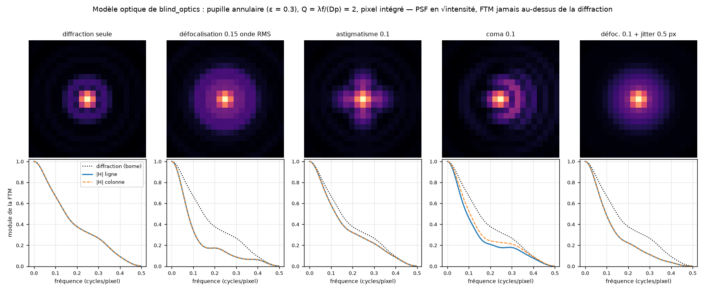

# Déconvolution aveugle

## 8. Déconvolution aveugle

Deux approches, qui diffèrent par ce que l'on sait de la PSF :

| | ``blind_l0`` (§8.1) | ``blind_optics`` (§8.2) |
|---|---|---|
| PSF | tableau libre ``k × k`` (positif, somme 1) | PSF d'un modèle physique de l'instrument (diffraction, aberrations de Zernike, jitter, pixel) |
| Inconnues | ``k²`` valeurs (225 pour 15 × 15) | 1 à 5 paramètres physiques bornés |
| Connaissance requise | taille du support | échantillonnage ``Q``, pupille, plages plausibles des aberrations |
| Cas d'usage | flou inconnu de forme quelconque (bougé) | instrument connu, réglage dérivé (défocalisation thermique, aberrations, variation dans le champ) |
| Risque | confondre détails de la scène et flou ; PSF non physique | modèle faux ou incomplet ; confusions résiduelles (§8.2.5) |

### 8.1 `blind_l0` — PSF libre, a priori L0

``backends/blind.py`` : ``blind_deconvolve(image, psf_size, sigma)``
renvoie ``(image, psf)`` ; ``blind_l0`` en est la forme à signature
commune (image seulement). **Expérimentale** : toujours examiner la PSF
estimée (``plotting.plot_psf``).

**Estimation de la PSF** (a priori L0 sur les gradients, Xu et al. 2013 ;
Pan et al. 2014), du grossier au fin (facteur √2, jusqu'à un support de
3 à 5 pixels) :

1. **pas en x** : ``min ‖h ∗ x − y‖² + λ‖∇x‖₀`` par éclatement
   semi-quadratique (Xu et al. 2011) : seuillage dur de ``∇x`` à
   ``√(λ/β)`` puis solution exacte en Fourier, ``β`` de 2λ à 1e5 par
   doublements. **Départ : l'image observée** — un départ par filtre
   inverse amplifie un bruit que le seuillage conserve ensuite comme
   contours ;
2. **pas en h** : ``min ‖h ∗ ∇x − ∇y‖² + γ‖h‖²`` (domaine des gradients,
   spectre presque plat), solution exacte en Fourier, ``γ = 1e-4·max|∇X|²``,
   restreinte au support, valeurs négatives et < 5 % du maximum annulées,
   somme 1, barycentre recentré ;
3. ``λ`` part de ``lam_l0 = 4e-3`` (image en [0, 1], valeur de Pan et
   al.) et décroît d'un facteur 0.9 par itération (plancher 1e-4) ;
   6 alternances par échelle.

**Restauration finale** : ``tv_primal_dual`` avec la PSF estimée
(``lam = 0.4``).

**Limites.** Gain de +0.5 à +4.2 dB selon la scène et le flou (contre
+4.5 à +6.9 dB pour la TV à PSF connue), variable d'une scène et d'un tirage à l'autre. La PSF n'est
définie qu'à une translation près (recentrée sur son barycentre) : le
résultat peut être décalé d'une fraction de pixel. Choisir ``psf_size``
proche de l'étendue attendue du flou : un support trop grand dégrade
fortement le résultat (sur l'image du benchmark, 21 px au lieu de 9 à
17 : −1 à −2 dB au lieu de +3 à +4 dB), un support un peu trop petit est
bien toléré.

### 8.2 `blind_optics` — aveugle contrainte par l'optique

``backends/optics_blind.py`` : ``optics_blind_deconvolve(image, model,
sigma)`` renvoie un ``OpticsBlindResult`` (image, PSF, paramètres
estimés, σ, tuiles) ; ``blind_optics`` en est la forme à signature
commune (modèle par mots-clés). Exemple complet :
``examples/blind_optics.py`` ; banc d'essai :
``examples/blind_optics_benchmark.py``.

#### 8.2.1 Pourquoi contraindre la PSF

Une déconvolution aveugle générique cherche ``(x, h)`` tels que
``h ∗ x ≈ y`` : le problème a deux fois plus d'inconnues que de mesures
et une infinité de solutions exactes, dont la solution triviale
``h = δ, x = y`` (« l'image n'est pas floue »). Ce qui départage les
solutions est **l'a priori** : sur ``x`` (contours parcimonieux, §8.1) et
sur ``h``. Un ``h`` libre de 225 valeurs peut absorber une part de la
scène (une texture régulière, un bord dominant) ou prendre une forme
qu'aucune optique ne produit. Pour un instrument dont on connaît la
conception, l'essentiel de la PSF est **connu** : diffraction par une
pupille de géométrie connue, échantillonnage par le détecteur, et seuls
quelques défauts sont inconnus et lentement variables — défocalisation
(dilatation thermique, vieillissement), aberrations de bas ordre
(astigmatisme, coma, sphérique), jitter. Contraindre ``h`` à ce modèle
ramène l'inconnue à quelques paramètres **bornés à des plages
plausibles**, et produit une PSF physique par construction :

- positive, de somme 1, aux anneaux de diffraction corrects ;
- **FTM sous la FTM de diffraction** à toute fréquence : pour une
  pupille ``P`` donnée, ``|OTF_φ(f)| = |∫ P e^{iφ} · P e^{−iφ'}| ≤
  ∫ P P' = OTF_0(f)`` (inégalité de Schwarz sur l'autocorrélation de la
  pupille) — une aberration ne relève jamais la FTM (vérifié par test).
  C'est la contrainte « |FTM| ≤ FTM d'Airy » discutée pour la 0.3.0,
  obtenue ici sans la formuler : elle est satisfaite par toute PSF du
  modèle, et la PSF de Dirac en est exclue.

#### 8.2.2 Modèle optique (``psf.optical_psf``)

Optique de Fourier (Fraunhofer), sur une grille fine de pas
``p/oversample`` (5 par défaut) :

    h = [ |TF( P(ρ, θ) · exp(2iπ W(ρ, θ)) )|² ⊛ G_jitter ] intégrée sur le pixel

- ``P`` : pupille annulaire, ``ε ≤ ρ ≤ 1`` (obturation ``ε``), bords
  anti-crénelés (``eoqual.core.psf.supersampled_coverage``) ;
- ``W = Σ_j a_j Z_j`` : front d'onde [ondes], polynômes de Zernike de
  Noll normalisés RMS 1 (``eoqual.core.pupil``) — ``a_j`` est l'écart RMS
  de front d'onde apporté par le mode ``j``, les écarts s'ajoutent en
  quadrature. Modes nommés : ``defocus`` (Z4), ``astig_45`` (Z5),
  ``astig_0`` (Z6), ``coma_y`` (Z7), ``coma_x`` (Z8), ``trefoil_y``,
  ``trefoil_x``, ``spherical`` (Z11) ; tout indice de Noll est accepté ;
- **échantillonnage** : ``Q = λf/(Dp)`` (2 : Nyquist ; ≈ 1 pour la
  plupart des imageurs d'observation de la Terre, sous-échantillonnés).
  Une pupille de ``D_px`` échantillons dans une FFT de ``N`` points donne
  un pixel focal de ``(D_px/N)·λf/D`` ; on choisit ``N`` et ``D_px``
  (≥ 48) tels que ce pixel vaille ``p/oversample`` et que la période de la
  PSF calculée couvre deux fois le support (pas de repliement des ailes) ;
- **jitter** : gaussienne d'écart-type ``jitter_sigma`` [pixels],
  appliquée en Fourier — vibrations aléatoires rapides devant le temps
  d'intégration, à ne pas confondre avec le filé ([§10.1](psf-simulation.md#101-jitter-et-filé--deux-mouvements-différents)) ;
- **pixel** : somme des ``oversample²`` sous-pixels (filtre boîte, FTM
  ``sinc``, facteur de remplissage 1) ;
- **bande spectrale** : ``sampling`` peut être une séquence (``Q ∝ λ``)
  pondérée par ``weights`` ; la phase est mise à l'échelle ``λ₁/λ``.

Défocalisation physique → coefficient : un déplacement ``Δz`` du plan
focal à ouverture ``N = f/D`` donne ``W₂₀ = Δz/(8N²)`` (crête, au bord de
pupille) et ``a₄ = W₂₀/(2√3 λ)`` ondes RMS (``psf.defocus_to_zernike``).
Ordres de grandeur : 0.05 onde RMS (Strehl ≈ 0.9) est un instrument bien
réglé ; 0.25 onde RMS (Strehl ≈ 0.1) une défocalisation franche.

Validation : sans aberration, identique à l'Airy annulaire analytique de
``system_psf`` à 0.4 % du pic (trois ``Q``, trois obturations) ; 3 ms par
PSF 15 × 15 (pupille et base de Zernike mises en cache).

*Schéma régénérable par ``python examples/figures.py``.*

#### 8.2.3 Estimation par vraisemblance marginale (``estimator="evidence"``, défaut)

Le maximum **joint** ``max_{x,h} p(x, h | y)`` favorise les PSF peu
étalées : une image nette ``x`` a des gradients plus parcimonieux qu'une
image floue, mais une image restaurée avec un ``h`` trop étroit reste
« plausible » et coûte moins cher en attache aux données. Levin et al.
(2011) montrent que ce biais disparaît si l'on **intègre** l'image
(``max_h p(h | y) = max_h ∫ p(y | x, h) p(x) dx``) : on compare les PSF
par la probabilité qu'elles donnent à l'image observée, toutes scènes
confondues. C'est la démarche de la déconvolution « marginale » de
Blanco & Mugnier (2011) pour l'optique adaptative, et le prolongement
naturel de Wiener–Hunt ([§3.5](methodes-classiques.md#35-wiener_hunt--wienerhunt-λ-et-σ-par-vraisemblance-marginale)), où la scène est déjà intégrée
analytiquement :

    J(θ) = min_{μ}  Σ_ω log s_θ(ω) + M log( moyenne_ω P(ω)/s_θ(ω) )
    s_θ(ω) = 1 + |H_θ(ω)|² / (μ G(ω)^{β/2}),   G = 4sin²(πf_y) + 4sin²(πf_x)

- ``P = |Y|²/N`` est calculé sur la **composante périodique** de l'image
  (Moisan 2011, ``eoqual.core.fourier.perdecomp``) : sans elle, la
  discontinuité des bords ajoute une « croix » d'énergie que le critère
  prendrait pour moins de flou ;
- σ est profilé ([§3.5](methodes-classiques.md#35-wiener_hunt--wienerhunt-λ-et-σ-par-vraisemblance-marginale)), le niveau ``μ`` de l'a priori est optimisé à
  chaque évaluation (L-BFGS-B à gradient analytique, départ à chaud) ;
- **exposant β** du spectre a priori de la scène (``prior_exponent``,
  défaut 3) : β = 4 est l'a priori laplacien de Hunt, β = 2 le spectre en
  ``1/f²`` des images naturelles (Field 1987). Sur 18 cas (trois scènes,
  trois jeux d'aberrations, deux bruits), l'écart moyen de PSNR à la
  restauration par la vraie PSF vaut 0.84 dB avec β = 3, 0.87 dB avec β
  libre dans [2.5, 3.5], 1.02 dB avec β libre dans [1.5, 4.5] et 1.47 dB
  avec β = 4 : β libre confond une petite défocalisation avec la pente du
  spectre (pire cas 5.7 dB), β = 4 sous-estime les défocalisations ;
- θ est optimisé par L-BFGS-B dans ses bornes (gradient par différences
  finies), depuis ``n_starts`` = 3 points répartis sur la plage du
  premier paramètre (le critère n'est pas convexe en θ) ;
- ``prior_std`` ajoute un a priori gaussien ``½ Σ ((θ − θ₀)/τ)²``
  centré au milieu des bornes, quand une valeur nominale est connue avec
  une incertitude.

#### 8.2.4 Estimation par les contours (``estimator="l0"``)

Alternative : le cadre de ``blind_l0`` (§8.1) avec une PSF paramétrique
— alternance entre l'image intermédiaire à gradients parcimonieux
(``min ‖h_θ ∗ x − y‖² + λ‖∇x‖₀``) et les paramètres
(``min_θ Σ_d ‖h_θ ∗ ∂_d x − ∂_d y‖²``), λ décroissant de 4e-3 à 1e-4,
six alternances, départ au milieu des plages. Exploite la forme des
contours de la scène, c'est-à-dire de l'information **au-delà du second
ordre** (phase de la fonction de transfert), à laquelle la
vraisemblance marginale gaussienne est aveugle.

#### 8.2.5 Ce qui est identifiable — et ce qui ne l'est pas

Le critère gaussien ne voit que ``|H_θ|²`` (les statistiques d'ordre
deux de l'image) ; le critère L0 voit aussi la phase, à travers les
contours. Conséquences, toutes observées sur les essais :

1. **Signe global.** ``φ → −φ`` change la PSF en sa symétrique par
   rapport au centre, de même ``|H|`` : indiscernable au second ordre. En
   particulier ``a₄`` et ``−a₄`` (défocalisation avant/arrière du plan
   focal) donnent la même image à pupille symétrique — d'où la borne
   basse 0 par défaut sur ``defocus``. Seule une diversité (deux images
   à défocalisations connues, comme en diversité de phase,
   eoqual-phaseretrieval) lève cette ambiguïté.
2. **Aberrations impaires** (coma, trefoil) : elles agissent surtout sur
   la phase de la FTO, peu sur son module ; le critère « evidence » les
   estime mal (§8.2.7 : coma en butée et défocalisation annulée dans
   trois cas sur six). Ne les libérer que si elles sont attendues, de
   préférence avec ``estimator="l0"``.
3. **Flou isotrope doux.** Une petite défocalisation, un jitter, la pente
   du spectre de la scène et le flou propre de la scène réduisent tous la
   FTM de façon lisse et monotone : ils se compensent. Avec défocalisation
   **et** jitter libres, le critère attribue tout au jitter ; sur une scène
   réduite par moyenne de blocs (qui ajoute elle-même un flou de pixel,
   écart-type 0.29 px), le jitter estimé vaut 0.42 px pour 0.35 px vrai,
   soit presque exactement ``√(0.35² + 0.29²) = 0.45`` : la méthode mesure
   le flou **total** entre la scène idéale et l'image, y compris ce qui
   appartient à la scène. **Fixer tout ce qui est connu** (jitter mesuré
   par le contrôle d'attitude, ``Q``, obturation) est la condition d'une
   estimation utile.
4. **Anisotropie de la scène ↔ astigmatisme.** Une scène urbaine à rues
   orientées a un spectre anisotrope que le critère peut expliquer par un
   astigmatisme : laisser l'astigmatisme libre seulement s'il est
   plausible, avec des bornes serrées, et vérifier sa stabilité d'une
   tuile à l'autre.
5. **Aberrations franches** (≥ 0.2 onde RMS) : la FTM a une forme propre
   (creux, remontée) qu'aucune pente de spectre n'imite ; la défocalisation
   est alors retrouvée exactement (0.25 → 0.24-0.25) et la restauration
   atteint celle de la vraie PSF.

#### 8.2.6 Variation dans le champ

``tile_size`` découpe l'image en tuiles chevauchantes
(``eoqual.core.tiling.tile_slices``, recouvrement 50 % par défaut). θ est
estimé sur chaque tuile, puis lissé par un **modèle de champ**
(``field_model``) : polynôme de la position normalisée du centre de la
tuile ajusté par moindres carrés — ``"constant"`` (moyenne),
``"plane"`` (défaut, basculement du plan focal) ou ``"quadratic"``
(courbure de champ : la défocalisation varie comme le carré de la
distance à l'axe) ; ``"independent"`` garde les estimations brutes
(``raw_params`` les conserve toujours). Le lissage met en commun
l'information de toutes les tuiles et filtre les estimations aberrantes
d'une tuile pauvre en structures. Chaque tuile est restaurée avec sa
PSF (marge inconnue de la méthode de restauration) et les tuiles sont
recollées par pondération de Hann normalisée. Taille de tuile : 128 px
au moins (le critère a besoin de fréquences et de structures).

Sur ``examples/blind_optics.py`` (512 × 512, défocalisation de 0.08 au
centre à 0.28 onde RMS aux coins, astigmatisme 0.05, jitter connu,
σ = 0.005) : PSF nominale 30.54 dB, ``blind_l0`` 31.17 dB, une PSF
estimée pour toute l'image 31.85 dB, tuiles de 128 px et champ
quadratique 32.06 dB, vraie PSF par tuiles 33.95 dB ; défocalisation
estimée 0.063 au centre (vraie 0.080) et 0.172 au coin (vraie 0.192).

#### 8.2.7 Résultats

``examples/blind_optics_benchmark.py`` (tableau complet dans
[benchmark §6](benchmark.md)) : Q = 1, obturation 0.3, jitter 0.35 px ; trois scènes
256 × 256 (« astronaut », extraits urbain et parc d'une orthophotographie
réduite d'un facteur 4) ; σ = 0.003 et 0.01 ; restauration TV avec la
PSF estimée. Écart moyen de PSNR à la restauration avec la **vraie** PSF
(plus petit = meilleur ; maximum entre parenthèses) :

| Cas (inconnues) | PSF nominale | ``blind_l0`` | ``blind_optics`` evidence | ``blind_optics`` l0 |
|---|---|---|---|---|
| défocalisation 0.12 (``defocus``) | 3.56 | 3.96 | 1.80 (3.17) | **1.06** (2.67) |
| défocalisation 0.25 (``defocus``) | 2.25 | 1.27 | **0.08** (0.19) | 0.60 (0.91) |
| défoc. 0.12 + astig. 0.06 (``defocus``, ``astig_0``, ``astig_45``) | 3.34 | 3.44 | **0.64** (1.37) | 1.36 (2.44) |
| défoc. 0.12, jitter **libre** (``defocus``, ``jitter``) | 3.56 | 3.96 | 1.85 (4.25) | **1.55** (3.23) |
| défoc. 0.2 + coma 0.06 (``defocus``, ``coma_x``, ``coma_y``) | 4.28 | 2.72 | 1.61 (4.27) | **1.51** (2.23) |
| **moyenne des 30 cas** | 3.40 | 3.07 | **1.19** | 1.22 |

Lecture :

- contraindre la PSF par l'optique divise par 2.5 l'écart à la vraie
  PSF par rapport à ``blind_l0`` (1.2 dB contre 3.1 dB), et ``blind_l0``
  fait parfois moins bien que la PSF nominale (scènes urbaine et parc) ;
- les deux critères sont **complémentaires**, conformément au §8.2.5 :
  ``evidence`` est quasi exact dès que l'aberration modifie nettement le
  module de la FTM (défocalisation franche : 0.25 → 0.24-0.25 ;
  astigmatisme), mais sous-estime une petite défocalisation (0.05 à 0.14
  pour 0.12) et échoue sur la coma dans trois cas sur six (défocalisation
  ramenée à 0, coma en butée : la coma n'agit presque que sur la phase) ;
  ``l0`` est plus régulier (pire cas 3.2 dB) et meilleur sur la petite
  défocalisation et la coma ;
- jitter libre : comme attendu, ``evidence`` l'estime à 0.41-0.51 px
  pour 0.35 px vrai et réduit la défocalisation en proportion — d'où la
  recommandation de fixer le jitter quand il est mesuré ;
- 2 à 9 s par image 256 × 256.

**Recommandation.** ``estimator="evidence"`` (défaut) pour les
défocalisations et astigmatismes attendus d'un instrument déréglé ;
``estimator="l0"`` pour de faibles défauts ou des aberrations impaires ;
sur données réelles, comparer les deux et vérifier la cohérence des
paramètres entre tuiles.

#### 8.2.8 Limites

- **Repliement.** Le modèle est discret, ``y = h ∗ x`` sur la grille du
  détecteur. Pour ``Q < 2`` la scène continue est repliée par
  l'échantillonnage : le repliement est traité comme une partie de la
  scène, ce qui suffit pour estimer ``h`` et restaurer sur la grille du
  détecteur, mais ne permet pas de super-résolution.
- **Bruit blanc gaussien stationnaire** supposé par le critère ; pour un
  bruit poisson-gaussien, stabiliser la variance d'abord (comme
  ``vst_denoise`` d'eoqual-denoising).
- **Données incomplètes** : l'estimation de θ suppose une image complète
  (pas de ``mask`` ni de ``saturation``) ; la restauration finale les
  accepte via ``restore_kwargs``.
- **Temps** : 2 à 15 s par image 256 × 256 et par jeu de paramètres
  (L-BFGS-B à différences finies, 3 départs) ; par tuiles, autant de fois
  le nombre de tuiles.
- Le modèle doit être **juste** : un ``Q`` ou une obturation faux sont
  compensés par des aberrations fictives. Vérifier les paramètres estimés
  au regard de la physique de l'instrument (un astigmatisme qui change de
  signe d'une tuile à la voisine signale une confusion avec la scène).
