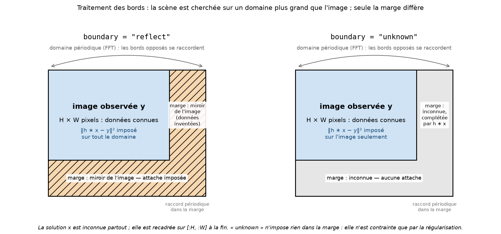

# Modèle, bords et données incomplètes

## 1. Modèle et notations

Observation ``y = h ∗ x + b`` : scène ``x``, PSF ``h`` (positive, somme
1), bruit ``b`` blanc d'écart-type σ. Sur un domaine périodique de ``N``
pixels, avec la FFT non normalisée : ``Y = H·X + B``, ``E|B(ω)|² = Nσ²``,
``H = psf2otf(h)`` (eoqual-core : centre de la PSF ``(kh // 2, kw // 2)``
ramené à l'origine, donc ``H`` réelle pour une PSF symétrique).

``BlurOperator`` (``operators.py``) porte ``H``, les opérations
``Hx``, ``Hᵀx``, le gradient ``Hᵀ(Hx − y)`` de ``½‖Hx − y‖²`` et sa
constante de Lipschitz ``max|H|²`` (1 pour une PSF positive de somme 1).

**Pourquoi la FFT.** La convolution est une application linéaire
``y = Hx`` dont la matrice ``N × N`` est inutilisable telle quelle
(10¹⁰ coefficients pour 10⁵ pixels). Sur un domaine périodique, ``H`` est
**circulante par blocs à blocs circulants** (BCCB) : la transformée de
Fourier discrète la diagonalise, et ses valeurs propres sont les
coefficients ``H(ω)``. ``Hx``, ``Hᵀx`` (multiplication par ``H*``) et
``(HᵀH + λLᵀL)⁻¹`` (division par ``|H|² + λ|L|²`` si ``L`` est aussi une
convolution) coûtent une FFT, ``O(N log N)``. Tout l'enjeu du traitement
des bords (§2) est de rendre ce cadre périodique légitime pour une image
qui ne l'est pas. Illustration pas à pas : [tutoriel](tutoriel.md), §1.

**Unités.** σ est toujours dans les unités de l'image. Les méthodes non
linéaires travaillent sur l'image ramenée à [0, 1] (``data_range``,
défaut : min/max de l'image) et expriment leur poids de régularisation en
**multiples de σ** ; les méthodes linéaires ont des paramètres sans
dimension. Toutes sont donc invariantes par changement d'échelle et de
décalage (sauf Richardson-Lucy : échelle seulement, modèle de Poisson),
ce que vérifie ``tests/test_methods.py::test_scale_invariance``.

**σ inconnu.** ``sigma=None`` : estimation de Donoho & Johnstone sur la
sous-bande d'ondelettes diagonale la plus fine
(``eoqual.core.noise.estimate_noise_sigma``, identique à
``skimage.restoration.estimate_sigma``). Sur une image floue, cette
sous-bande contient peu de signal : l'estimation est fiable (±15 % dans
les tests) ; elle sous-estime un bruit corrélé.

## 2. Bords et données incomplètes

### 2.1 Bords

Toutes les méthodes résolvent le problème sur un domaine périodique. Une
image réelle ne l'est pas : la discontinuité entre bords opposés produit
des oscillations sur toute l'image restaurée. ``boundary`` :

- **``"reflect"``** : l'image est prolongée d'une marge d'au moins deux
  tailles de PSF au total (taille rapide pour la FFT), placée après
  l'image. Dans la marge, le miroir du bord de fin se fond, par une
  pondération en cosinus surélevé, dans le miroir du bord de début : le
  domaine de travail est **continu et périodique**. La marge est traitée
  comme mesurée. Le résultat est recadré sur ``[:H, :W]`` ;
- **``"unknown"``** : même marge, mais traitée comme une **donnée
  inconnue** (§2.2) : seule l'image d'origine contraint la solution
  (Almeida & Figueiredo 2013). Le plus exact ;
- **``"perdecomp"``** : décomposition périodique + lisse de Moisan
  (eoqual-core) ; seule la composante périodique est déconvoluée, la
  composante lisse (basses fréquences, quasi insensible au flou) est
  rajoutée. Pas de marge, approximatif près des bords ; incompatible avec
  ``mask`` et ``saturation`` ;
- **``"periodic"``** : aucun traitement, exact pour une simulation par
  convolution circulaire.

#### Le mode ``"unknown"`` en détail

**Le problème.** Près d'un bord, chaque pixel observé mélange, par le
flou, des points de la scène situés *hors du champ* : la scène réelle se
poursuit au-delà de l'image, mais on n'en a aucune mesure. La FFT, elle,
suppose que l'image se répète périodiquement : le bord droit « touche »
le bord gauche. Le modèle ``y = h ∗ x`` est donc faux sur une bande de la
largeur de la PSF autour de l'image.

**L'idée.** On cherche une scène ``x`` **plus grande que l'image** —
l'image plus une marge — et on n'impose l'accord avec les données que là
où il y a des données (Almeida & Figueiredo 2013) :

*Schéma régénérable par `python examples/figures.py`.*

``min_x ‖C(h ∗ x) − y‖² + R(x)``, où ``C`` ne garde que les pixels de
l'image. La marge de ``x`` n'est contrainte que par la régularisation
``R`` et par la continuité avec l'image : c'est une **extrapolation** de
la scène hors du champ, que l'on jette à la fin (recadrage sur
``[:H, :W]``). La FFT reste utilisable, puisque le domaine de travail
complet, lui, est traité comme périodique : la discontinuité au raccord
tombe dans une zone où rien n'est imposé.

**Mise en œuvre.** Plutôt qu'un opérateur de recadrage explicite, les
données de la marge sont **complétées à chaque itération par le flou de
l'estimée courante**, ``h ∗ x`` (§2.2) : le résidu y est nul, donc la
marge ne tire pas la solution. Pour les méthodes à gradient (Landweber,
FISTA, TV, Plug-and-Play), c'est exactement le gradient du problème
ci-dessus ; pour les méthodes linéaires, la boucle « compléter puis
résoudre » (``n_fill_iter = 30``) converge vers sa solution (EM).

**Différence avec ``"reflect"``.** ``"reflect"`` remplit la marge de
*données inventées* (le miroir de l'image) et demande à la solution de
les expliquer. Or un miroir n'est pas une image floue par la PSF — le
flou d'un bougé, par exemple, n'est pas symétrique : l'incohérence est
amplifiée par l'inversion, d'autant plus que la FTM a des zéros.
``"unknown"`` ne fait aucune hypothèse sur la scène hors champ.

| Flou de bougé, TV ([tutoriel](tutoriel.md), §7) | PSNR |
|---|---|
| ``"periodic"`` (rien) | 18.14 dB |
| ``"reflect"`` (marge inventée) | 27.67 dB |
| ``"unknown"`` (marge inconnue) | 29.74 dB |

**Coût.** Aucun pour les méthodes itératives ; ``n_fill_iter`` FFT
supplémentaires pour les méthodes linéaires (0.1 à 0.3 s pour 512×256).

**Quand le préférer.** Toujours acceptable ; indispensable dès que la
FTM s'annule (bougé, défocalisation forte). Exception mesurée :
Richardson-Lucy et Landweber, régularisés par le nombre d'itérations,
gardent ``"reflect"`` — les données de la marge y freinent utilement
l'amplification du bruit près des bords.

**Défaut par méthode**, d'après les mesures ([benchmark §4](benchmark.md)) :

| Méthodes | Défaut | Raison |
|---|---|---|
| ``wiener``, ``tikhonov``, ``fista_wavelet``, ``tv_primal_dual`` | ``"unknown"`` | +0.8 à +2.2 dB sur flou de bougé (OTF à zéros), au plus −0.06 dB ailleurs |
| ``inverse``, ``richardson_lucy``, ``landweber`` | ``"reflect"`` | ``"unknown"`` y est neutre (Richardson-Lucy : +0.07 dB) ou défavorable (inverse, Landweber : jusqu'à −0.5 dB) : régularisées par un seuil ou le nombre d'itérations, elles profitent des données synthétiques de la marge |
| ``pnp_hqs``, ``pnp_admm`` | ``"reflect"`` | marge déjà complétée (``fill_boundary``, [§7](plug-and-play.md#7-plug-and-play-et-réseaux-dépliés)) : identique à ``"unknown"`` |

Un miroir simple de chaque côté (``np.pad(..., "symmetric")``) laisse une
discontinuité au raccord périodique des deux marges. Son énergie haute
fréquence, inexpliquée par le flou, fausse les critères de réglage :
GCV et discrépance choisissent λ ≈ 1e-10 (Tikhonov à −33 dB) ; voir
[§13](pistes.md#13-variantes-écartées).

### 2.2 Données incomplètes : pixels masqués, saturés, marge inconnue

``backends/_common.py``. Chaque pixel du domaine de travail est :

- **connu** : attache aux données ``(h ∗ x − y)²`` ;
- **inconnu** (``mask=False``, NaN, marge de ``"unknown"``) : aucune
  attache ; la valeur initiale est celle du plus proche pixel connu ;
- **saturé** (``saturation=L``, pixels valides ``≥ L``) : la vraie valeur
  floue est seulement connue pour être ``≥ L`` ; attache unilatérale
  ``min(h ∗ x − L, 0)²``.

Toutes les méthodes (sauf ``wiener_unsupervised`` et ``blind_l0``, qui
refusent ces options) passent par la même opération ``Problem.fill`` :
les données sont **complétées par l'estimée courante**, ``h ∗ x`` aux
pixels inconnus et ``max(h ∗ x, L)`` aux pixels saturés.

- **Méthodes à gradient** (Landweber, FISTA, TV) : ``Hᵀ(Hx − fill(Hx))``
  est exactement le gradient de l'attache masquée et unilatérale.
- **Méthodes linéaires** (inverse, Wiener, Tikhonov) : la boucle
  « compléter puis résoudre » (``n_fill_iter = 30``) est l'algorithme EM
  des données manquantes (Dempster, Laird & Rubin 1977) ; son point fixe
  vérifie ``Hᵀ M (Hx − y) + λLᵀL x = 0``, l'équation normale du problème
  masqué. Coût : ``n_fill_iter`` FFT supplémentaires (0.1 à 0.3 s pour
  512×256).
- **Richardson-Lucy** : ``x ← x · Hᵀ(fill(Hx) / Hx)``, l'EM du modèle de
  Poisson à données manquantes ; pour des bords inconnus, c'est la
  méthode de Bertero & Boccacci (2005).
- **Plug-and-Play** : remplissage à chaque itération ([§7](plug-and-play.md#7-plug-and-play-et-réseaux-dépliés)).
- Le principe de discrépance (Landweber, Tikhonov) compte les seuls
  pixels connus.

Mesures (flou gaussien σ = 2 px, bruit 0.01, image d'évaluation du
benchmark, [benchmark §4](benchmark.md)) :

- **une ligne sur 25 à 0** : sans masque, l'image est détruite (−56 à
  +15 dB selon la méthode) ; avec ``mask=``, à 0.15 dB au plus de la
  restauration sans défaut ;
- **flou écrêté à 85 % de son maximum** (6 % de pixels saturés) :
  +0.3 à +1.4 dB avec ``saturation=`` (TV : 28.19 → 29.59 dB), sans
  changement hors des zones saturées ;
- **flou de bougé, marge inconnue** : voir le tableau du §2.1.
